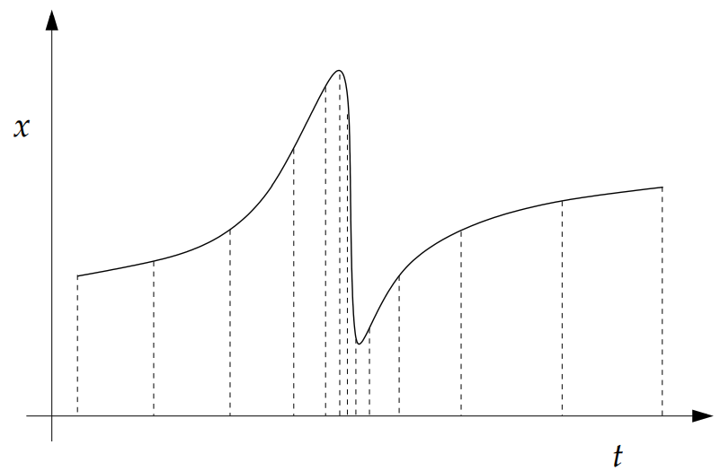
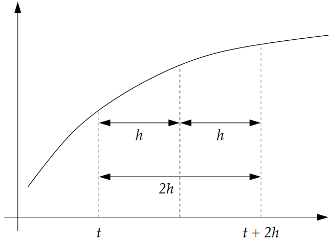
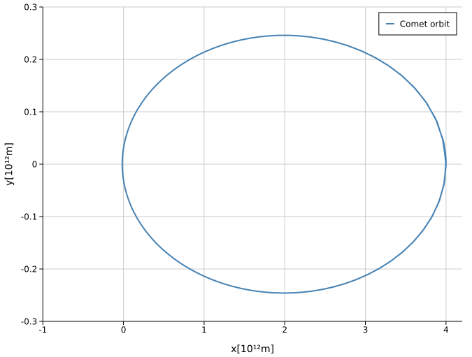
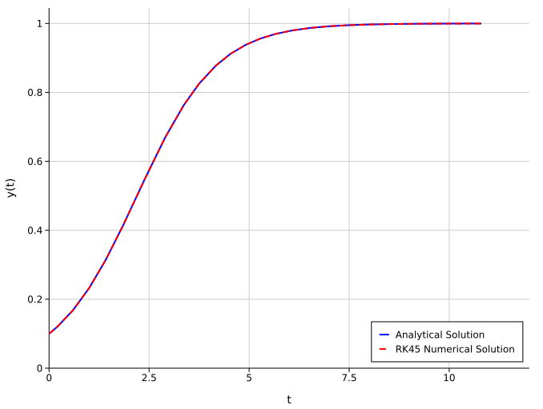

# **Adaptive Methods**
So far, all the methods we have used employ a fixed step size that must be chosen in advance. However, it seems reasonable to expect more accurate and efficient results if the step size could be adjusted while the program is running, allowing the optimal step size to be chosen at each point.

Suppose the ODE $x'= f(t,x)$ is given by:



In some regions, the solution varies slowly, so its behavior can be captured using only a few points. In other regions, it changes abruptly, requiring the function to be evaluated at many more points.

The goal, therefore, is to vary the step size $h$ as we construct the solution: take larger steps where the solution is smooth and smaller steps where it changes rapidly.

This can make the program both faster and more accurate because the step size adapts to the behavior of the solution. This is the basic idea behind adaptive step-size methods.

Adaptive methods have two stages:
1. Estimate the error associated with a step while computing the solution.
2. Compare the estimated error with the target tolerance, then increase or decrease the step size to achieve the desired accuracy.

## **Runge-Kutta with Adaptive Step**
The RK4 method with adaptive step size works as follows:
1. Choose an initial step size, typically a small one to be cautious.
2. Compute the solution using two consecutive steps of size $h$. Starting from $x(t)$, this gives an estimate of $x(t+2h)$.
3. Return to the starting point and take a single step of size $2h$, producing a second estimate of $x(t+2h)$.
As with adaptive methods for integrals, comparing these two estimates gives us an estimate of the error.



RK4 expect the error to go as $\mathcal{O}(h^5)$. If we make two steps the error will be roughly $2ch5$

$$
x(t+2h) \approx x_1 + 2ch^5
$$

where $x_1$ is obtain from RK4 and $c$ is a  constant that we assume to be equal for both steps

If we make a step of size $2h$

$$
x(t+2h) \approx x_2 + c(2h)^5 = x_2 + 32ch^5
$$

So the difference between our
two estimates

$$
x_1 - x_2 = 30 ch^5
$$

The error $\epsilon=ch^5$ would then be

$$
\epsilon = \frac{1}{30}(x_1-x_2)
$$


The goal, then, is to make this error equal to our target tolerance. Let $\epsilon_{\text{obj}}$ denote that tolerance, which we can assume corresponds to a step of size $h'$. Then:

$$
\epsilon_{\text{obj}} = ch'^5
= ch^5\left(\frac{h'}{h}\right)^5
= \frac{1}{30}(x_1-x_2)\left(\frac{h'}{h}\right)^5
$$

Let the target accuracy for our calculation be $\delta$, then the
accuracy for each step would need to be $h'\delta$. We want the
value of $h'$ so that the actual accuracy equals the target
accuracy or

$$
\epsilon_{\text{obj}} = h'\delta
= \frac{1}{30}(x_1-x_2)\left(\frac{h'}{h}\right)^5
\Rightarrow
h' = h\left(\frac{30h\delta}{|x_1-x_2|}\right)^{1/4}
= h\rho^{1/4}
$$
where the quotient

$$
\rho = \frac{30h\delta}{|x_1 - x_2|}
$$

It gives the ratio of the target accuracy to the error in our current estimate $\epsilon$

Therefore, the RK4 algorithm with adaptive step size works as follows:

1. Choose a target accuracy $\epsilon_{\text{obj}} = h\delta$, where $\delta$ is the desired tolerance.
2. Starting from the current initial condition, compute two estimates at $t+2h$: one using two RK4 steps of size $h$, and another using a single RK4 step of size $2h$. Use their difference to calculate the ratio $\rho$ between the target accuracy and the estimated error.
3. Adjust the step size based on $\rho$:
    - If $\rho > 1$, the estimated error is below the target tolerance. Accept the two-step result and continue from $t+2h$. For the next trial, increase the step size to $h' = h\rho^{1/4}$, subject to a maximum increase.
    - If $\rho \leq 1$, the estimated error is too large. Reject the step, return to the current starting point, and repeat the calculation with the smaller step size $h' = h\rho^{1/4}$.

In general, adaptive RK methods require more work per step than fixed-step methods. However, they control the error and can often run faster overall because they use larger steps where the solution varies smoothly.

Occasionally, $x_1$ and $x_2$ may be nearly equal by chance, making the estimated error very small and the proposed next step very large. To avoid this, limit how much the step size can increase in one iteration. A common choice is to cap it at twice its current value.

**Example: Applying RK4 Adaptive to a Comet’s Orbit**

Comets typically travel in highly elongated elliptical orbits. According to Kepler’s second law, they spend most of their time far from the Sun, where their orbital speed is lower. As they approach the Sun, they move much faster.

Adaptive step-size methods are especially useful for simulating this system. When the comet moves slowly, we can use larger steps; as it approaches the Sun and speeds up, the step size can be reduced.

The equations describing the comet’s motion in a plane are as follows:

$$
\frac{d^2x}{dt^2} = -GM \frac{x}{r^3}
$$

$$
\frac{d^2y}{dt^2} = -GM \frac{y}{r^3}
$$

where $r=\sqrt{x^2+y^2}$ is the comet’s distance from the Sun, $G$ is the gravitational constant, and $M$ is the mass of the Sun.

Find its solution to within a tolerance of $\delta=1 \mathrm{[Km/year]}$, subject to the initial conditions $x(0)=410^9 \mathrm{[Km]}$, $y(0)=0$, $v_x(0)=0$ and  $v_y(0)=500 \mathrm{[ms^{-1}]}$.


```rust
use std::time::Instant;

fn rk4_step<F>(system: &F, t: f64, state: &[f64], h: f64) -> Vec<f64>
where
    F: Fn(f64, &[f64]) -> Vec<f64>,
{
    let k1: Vec<f64> = system(t, state).iter().map(|derivative| h * derivative).collect(); // k1 = h * f(t, r)

    let values_k2: Vec<f64> = state.iter().zip(&k1).map(|(value, k)| value + k / 2.0).collect();
    let k2: Vec<f64> = system(t + h / 2.0, &values_k2).iter().map(|derivative| h * derivative).collect(); // k2 = h * f(t + h/2, r + k1/2)

    let values_k3: Vec<f64> = state.iter().zip(&k2).map(|(value, k)| value + k / 2.0).collect();
    let k3: Vec<f64> = system(t + h / 2.0, &values_k3).iter().map(|derivative| h * derivative).collect(); // k3 = h * f(t + h/2, r + k2/2)

    let values_k4: Vec<f64> = state.iter().zip(&k3).map(|(value, k)| value + k).collect();
    let k4: Vec<f64> = system(t + h, &values_k4).iter().map(|derivative| h * derivative).collect(); // k4 = h * f(t + h, r + k3)

    state.iter().enumerate().map(|(j, value)| {
            value + (k1[j] + 2.0 * k2[j] + 2.0 * k3[j] + k4[j]) / 6.0
        }).collect() // r_next = r + (k1 + 2*k2 + 2*k3 + k4)/6
}

fn rk4_adaptive<F>(system: F, mut r: Vec<f64>, t_max:f64, initial_step:f64, delta:f64) -> (Vec<(f64, f64)>, Vec<(f64, f64)>)
where
    F: Fn(f64, &[f64]) -> Vec<f64>
{
    assert!(t_max > 0.0, "t_max must be greater than 0");
    assert!(initial_step > 0.0, "initial_step must be greater than 0");
    assert!(delta > 0.0, "delta must be greater than 0");

    let mut x_points = vec![(0.0, r[0])];
    let mut y_points = vec![(0.0, r[1])];

    let mut t = 0.0;
    let mut h = initial_step;

    while t < t_max {
        // Make a big step 2h
        let r1 = rk4_step(&system, t, &r, 2.0 * h);
        
        // Make two small steps h
        let midpoint = rk4_step(&system, t, &r, h);
        let r2 = rk4_step(&system, t + h, &midpoint, h);

        // Compute the value of the precision ratio
        let dx = r1[0] - r2[0]; // Error in x
        let dy = r1[1] - r2[1]; // Error in y
        let rho = 30.0 * h * delta / (dx * dx + dy * dy).sqrt(); // Precision ratio

        // Adjust the step size based on the precision ratio
        if rho >= 1.0 {
            // Accept the step and update the state
            t += 2.0 *h;
            h *= rho.powf(0.25).min(2.0); // Increase the step size, but limit it to a maximum of double the current step size
            r = r2;
            x_points.push((t, r[0]));
            y_points.push((t, r[1]));
        } else {
            // Reject the step and reduce the step size
            h *= rho.powf(0.25); // Decrease the step size, but limit it to a minimum of 10% of the current step size
        }
    }
    
    (x_points, y_points)
}

const G: f64 = 6.67430e-11; // m^3 kg^-1 s^-2
const M_SUN: f64 = 1.9885e30; // kg

fn main() {
    
    let comet = |_t: f64, state: &[f64]| -> Vec<f64> {
        let x = state[0]; 
        let y = state[1]; 
        let vx = state[2]; 
        let vy = state[3];

        vec![
            vx,
            vy,
            -(G * M_SUN) * x / (x.powi(2) + y.powi(2)).powf(1.5),
            -(G * M_SUN) * y / (x.powi(2) + y.powi(2)).powf(1.5)
        ]
    };

    let initial = vec![4.0e12, 0.0, 0.0, 500.0]; // [x, y, v_x, v_y]

    let t_max = 3.2e9; // Approximately 2 orbits of Comet
    let initial_step = 1.0e4; // Initial step size of 10_000 Km
    let delta = 1.0e3/365.25/3600.0; // Desired precision for adaptive step size in Km/s

    let start = Instant::now();
    let (x_data, y_data) = rk4_adaptive(comet, initial, t_max, initial_step, delta);
    let end = start.elapsed();

    println!("RK4 Adaptive Method took {} microseconds.", end.as_micros());
}
```



## **Runge-Kutta-Fehlberg (RK45)**

RK45 is a method that combines the fourth- and fifth-order Runge–Kutta methods. The fifth-order estimate reuses the stages calculated for the fourth-order estimate, so both estimates can be obtained efficiently. Comparing them provides an estimate of the local error.

The equations for the stages are:

$$
k_1 = h f(t, x)
$$

$$
k_2 = h f\left(t + \frac{h}{4},\, x + \frac{k_1}{4}\right)
$$

$$
k_3 = h f\left(t + \frac{3h}{8},\, x + \frac{3k_1}{32} + \frac{9k_2}{32}\right)
$$

$$
k_4 = h f\left(t + \frac{12h}{13},\, x + \frac{1932k_1}{2197} - \frac{7200k_2}{2197} + \frac{7296k_3}{2197}\right)
$$

$$
k_5 = h f\left(t + h,\, x + \frac{439k_1}{216} - 8k_2 + \frac{3680k_3}{513} - \frac{845k_4}{4104}\right)
$$

$$
k_6 = h f\left(t + \frac{h}{2},\, x - \frac{8k_1}{27} + 2k_2 - \frac{3544k_3}{2565} + \frac{1859k_4}{4104} - \frac{11k_5}{40}\right)
$$

The fifth-order approximation is:

$$
x(t+h) \approx x(t) + \frac{16}{135}k_1 + \frac{6656}{12825}k_3 + \frac{28561}{56430}k_4 - \frac{9}{50}k_5 + \frac{2}{55}k_6
$$

where the error is given by

$$
\epsilon = \frac{1}{360}k_1 - \frac{128}{4275}k_3 - \frac{2197}{75240}k_4 + \frac{1}{50}k_5 + \frac{2}{55}k_6
$$

Knowing the error allows the method to adjust the step size at each step to meet the desired tolerance.

One advantage of this method is that it requires only six evaluations of $f$ per step.

**Example: Applying the RK45 Method to the Logistic Equation**

The logistic equation, also known as the Verhulst equation, is a nonlinear ODE used to model growth under limiting conditions. It can describe population growth, the spread of a new technology, or the spread of an epidemic or rumor.

The model assumes that the relative growth rate of a quantity $y(t)$, given by $\frac{y'(t)}{y(t)}$, is proportional to the remaining capacity $M-y(t)$. Thus,

$$
y'(t) = k y (M - y)
$$

where $k>0$ is a proportionality constant and $M>0$ is the maximum capacity, such as the maximum population size.

This equation can be solved analytically by separating variables.

$$
y(t)=\frac{M y_0}{(M-y_0)e^{-kM(t-t_0)}+y_0}
$$

For simplicity assume that $k= M = 1$ and that the initial population is $y_0=0.1$. Use a minimum step size of $h_{\min}=0.01$ and a maximum step size of $h_{\max}=0.25$, with a tolerance of $10^{-5}$ over the interval $t \in [0,10]$.

```rust
use std::time::Instant;

fn rk45<F>(function: F, initial: f64, a: f64, b: f64, min_step: f64, max_step: f64, tol: f64) -> Vec<(f64, f64)> 
where
    F: Fn(f64, f64) -> f64
{   
    let mut y_points = vec![initial];
    let mut t_points = vec![a];

    let mut t = a;
    let mut h = min_step;

    let mut y = initial;

    while t < b {
        let k1 = function(t, y);
        let k2 = function(t + h / 4.0, y + h * k1 / 4.0);
        let k3 = function(t + 3.0 * h / 8.0, y + h * (3.0 * k1 / 32.0 + 9.0 * k2 / 32.0));
        let k4 = function(t + 12.0 * h / 13.0, y + h * (1932.0 * k1 / 2197.0- 7200.0 * k2 / 2197.0+ 7296.0 * k3 / 2197.0));
        let k5 = function(t + h,y + h * (439.0 * k1 / 216.0- 8.0 * k2+ 3680.0 * k3 / 513.0- 845.0 * k4 / 4104.0));
        let k6 = function(t + h / 2.0,y + h * (-8.0 * k1 / 27.0+ 2.0 * k2- 3544.0 * k3 / 2565.0+ 1859.0 * k4 / 4104.0- 11.0 * k5 / 40.0));

        let error = h * (k1 / 360.0 - 128.0 * k3 / 4275.0 - 2197.0 * k4 / 75240.0 + k5 / 50.0 + 2.0 * k6 / 55.0).abs();

        if error <= tol {
            // Accept the step and update the solution
            y += h * (16.0 * k1 / 135.0 + 6656.0 * k3 / 12825.0 + 28561.0 * k4 / 56430.0 - 9.0 * k5 / 50.0 + 2.0 * k6 / 55.0);
            t += h;
            y_points.push(y);
            t_points.push(t);
        }

        // Adjust the step size, but limit to max_step or min_step
        let delta = 0.84 * (tol / error).powf(0.25);

        if delta <= 0.1 {
            h *= 0.1;
        } else if delta >= 4.0 {
            h *= 4.0;
        } else {
            h *= delta;
        }

        // Clamp the step size to be within the specified bounds
        h = h.clamp(min_step, max_step);
    }

    t_points.into_iter().zip(y_points).collect()
}


fn main() {

    let ode = |_t: f64, y: f64| -> f64 {
        y * (1.0 - y)
    };
    
    let solution = |t: f64| -> f64 {
        0.1 / ((1.0 - 0.1) * (-1.0 * (t - 0.0)).exp() + 0.1)
    };

    let start = Instant::now();
    let numerical_data = rk45(ode, 0.1, 0.0, 10.0, 0.01, 1.0, 1e-6);
    let end = start.elapsed();

    let analytical_data: Vec<(f64, f64)> = numerical_data.iter().map(|(t, _y)| (*t, solution(*t))).collect();

    println!("RK45 Adaptive Method took {} microseconds.", end.as_micros());
}
```

