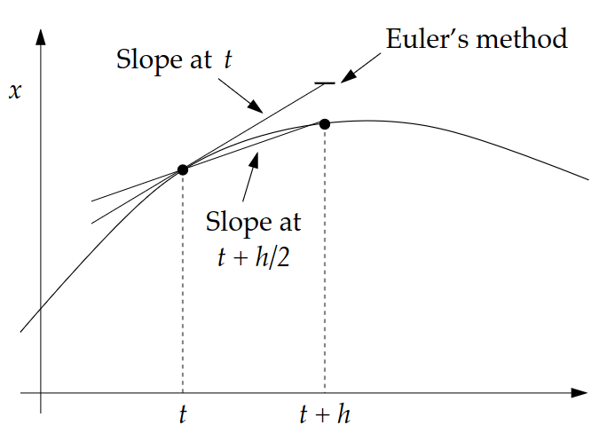
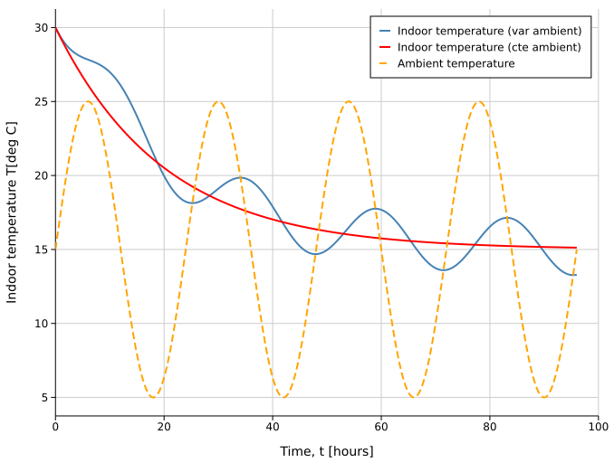
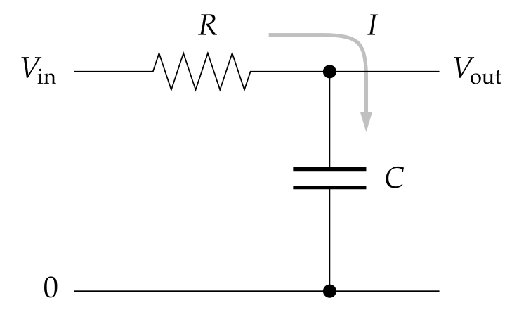
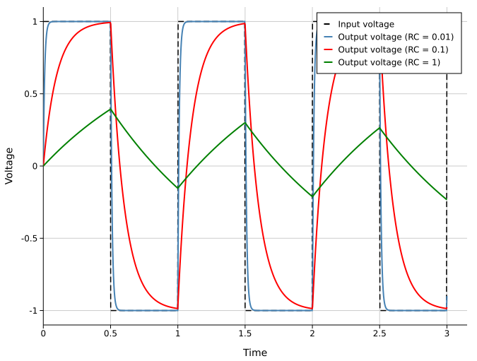
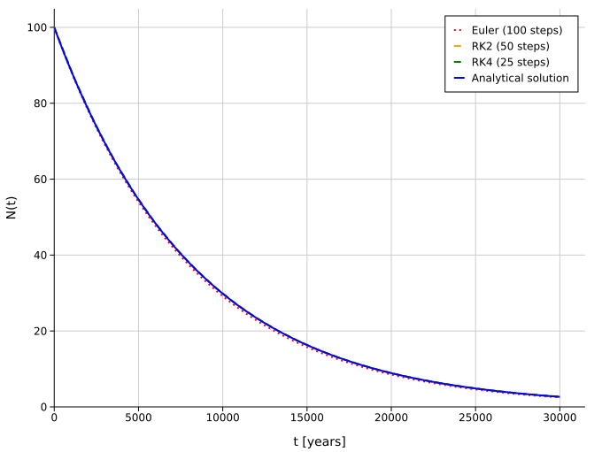
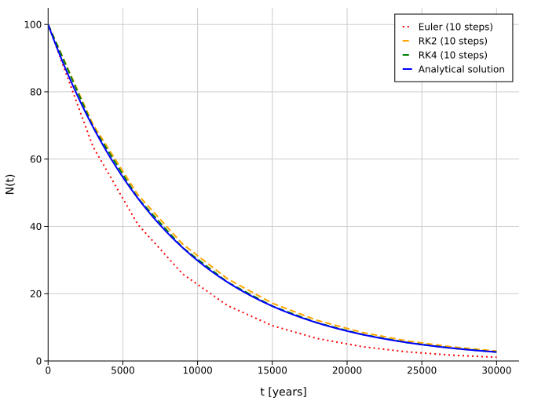
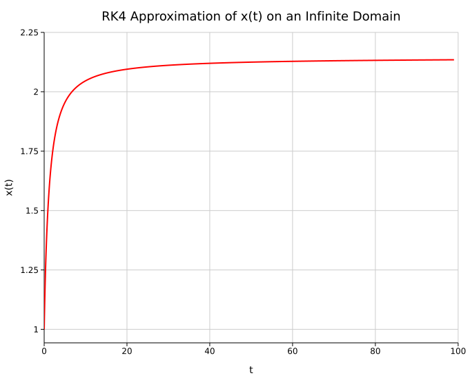

# **First-Order ODEs in One Independent Variable**

\\[ \frac{dx}{dt}  = f(t, x),\quad \forall t \in D = [ a, b ] \\]

Subject to the initial condition \\(y(a)=\alpha\\)

The system has a unique solution if satisfies the **Picard-Lindelöf theorem**
- \\(f(x, t)\\) is continous in \\(D = [a,b]\\)
- Lipschitz Condition -> \\(|f(t, x_1) - f(t, x_2)| \leq L |x_1 - x_2 |,\\) where \\(L\\) is the Lipschitz constant for \\(f\\)

**Example:**

Consider
\\[ x'  = f(t, x) = -2t - x \\]
- \\(f(x, t)\\) is a polynomial -> continuous
- Lipschitz Condition -> \\(|(-2t - x_1) - (-2t -x_2)| =  |x_2 - x_1| \leq L |x_1 - x_2 | \Rightarrow\\) \\(f\\) satisfies the Lipschitz Condition with \\(L=1\\)


## **Euler Method**
Euler’s method is the simplest numerical method for solving an IVP.

First, we discretize the interval \\(D = [a,b]\\) uniformly.

\\[ t_i = a + ih,\quad i = 0,1,2,\ldots,N  \\]

The step size is \\(h=\frac{b-a}{N}\\)

Using the **Taylor expansion**, we can approximate the value of \\\(x\\) after one step:

\\[ x(t + h) = x(t) + h \frac{dx}{dt} + \frac{1}{2}h²\frac{d²x}{dt²} + \ldots = x(t) + h f(t,x) + \mathcal{O}(h²) \\]

In general, Euler’s method is given by

\\[ x_{i+1} \approx x_i + h f(t_i,x_i) \\]

Euler’s method is not bad; however, we never
actually use it because with a little extra effort we can get a
method, Runge-Kutta that is more accurate and often faster.

The error in Euler’s method goes as \\(\mathcal{O}(h²)\\), but this is
for each step. The total error using Euler’s method:

\\[
\sum_{k=0}^{N-1} \frac{1}{2}h^2 \left( \frac{d^2 x}{dt_k^2} \right)
= \frac{1}{2}h \sum_{k=0}^{N-1} h \frac{df(t,x)}{dt_k}
\approx \frac{1}{2}h \int_a^b \frac{df(t,x)}{dt}dt
= \frac{1}{2}h \left[f(b,x(b))-f(a,x(a))\right]
\\]

The total error goes as \\(\mathcal{O}(h)\\) instead of \\(\mathcal{O}(h²)\\). This means that if we
choose \\(h\\) small enough we should be able to get reasonable
results, but \\(h\\)  might have to be very small and therefore \\(N\\) 
very large. If \\(h\\)  is too small we have to worry about roundoff
errors.

**Example: Applying Euler’s Method to a Nonlinear Spring with Sinusoidal Forcing**

Apply Euler’s method to solve the following initial-value problem, which models a nonlinear spring with a cubic restoring force and sinusoidal forcing:

\\[ \frac{dx}{dt} = -x³ + sin(t) \\]

under the interval \\([0,15]\\) using 1,000 equally spaced points with the initial condition \\(x(0)=1.32\\)

```rust
use std::time::Instant;

fn euler<F>(function: F, initial: f64, a: f64, b: f64, n: usize,) -> Vec<(f64, f64)> 
where
    F: Fn(f64, f64) -> f64
{
    assert!(n > 0, "n must be greater than 0");

    let h: f64 = (b - a) / n as f64;

    let t_points: Vec<f64> = (0..=n)
        .map(|i| a + i as f64 * h)
        .collect();
    
    let mut x_points: Vec<f64> = Vec::with_capacity(n + 1);

    let mut x : f64 = initial;

    for t in t_points.iter() {
        x_points.push(x);
        x += h * function(x, *t)
    }
    
    t_points.into_iter().zip(x_points).collect()
}

fn main() {
    let function = |x: f64, t: f64| - x.powi(3) + t.sin();

    let start = Instant::now();
    let data: Vec<(f64, f64)> = euler(function, 1.32, 0.0, 15.0, 1_000);
    let end = start.elapsed();

    println!("Euler Method took {} microseconds.", end.as_micros());
}
```


## **Runge-Kutta Methods**

Higher-order Taylor methods have the desirable property of providing a high-order local truncation error. However, they require calculating and evaluating derivatives of $f(t,x)$, a process that is slow and complicated for many problems. For this reason, Taylor methods are rarely used in practice.

Runge–Kutta methods also achieve a high-order local truncation error, but they do so without requiring the calculation or evaluation of derivatives of $f(t,x)$.

As we saw with numerical differentiation methods, accuracy can be improved by combining function evaluations at carefully chosen points so that higher-order terms in the Taylor expansion match or cancel. Runge–Kutta methods use this idea to approximate the solution of an initial value problem without explicitly calculating higher derivatives.


### Order 2 (RK2)
We can think of Euler’s
method graphically. Then
what we did was take the
slope at the point \\(t\\) , and
then used that line to
extrapolate what the
function would be at \\(t+h\\) 

The idea of RK2 is
that instead we calculate
the slope at \\(t+h/2\\) and
then extrapolate this slope
to get \\(x(t+h)\\). This usually
gives a better estimate.



Whereas Euler’s method evaluates the solution’s derivative at $t$, introducing an error proportional to its second derivative,
this $\mathcal{O}(h^2)$ error can be canceled by evaluating the derivative at the midpoint.

To see how accurate such a method would be let us again perform
a Taylor expansion, but now in $t$ around $t+h/2$

$$
x(t + h) = x\left(t + h/2\right) + \frac{1}{2}h \left( \frac{dx}{dt} \right)_{t+h/2} + \frac{1}{8}h^2 \left( \frac{d^2x}{dt^2} \right)_{t+h/2} + \mathcal{O}(h^3)
$$


We can also derive an expression for \\(x(t)\\)

$$
x(t) = x\left(t + h/2\right) - \frac{1}{2}h \left( \frac{dx}{dt} \right)_{t+h/2} + \frac{1}{8}h^2 \left( \frac{d^2x}{dt^2} \right)_{t+h/2} + \mathcal{O}(h^3)
$$

If we subtract these two equations we get:

$$
x(t+h) = x\left(t\right) + h \left( \frac{dx}{dt} \right)_{t+h/2} +  \mathcal{O}(h^3) = x\left(t\right) + h f(t+h/2, x(t+h/2))+  \mathcal{O}(h^3) 
$$

This is an expression for $x(t+h)$ that is accurate to $h^2$, the error is
$\mathcal{O}(h^3)$. Thus it is a second order scheme instead of first order as Euler’s method.

The only problem with this expression is that it includes the
value of the function evaluated at $t+h/2$ which we don’t
know. We get around this by using Euler’s method to
estimate $x(t+h/2)$ and then using that estimate in the RK2 formula to get $x(t+h)$.

$$
x(t+h/2) = x\left(t\right) + \frac{1}{2}h f(t,x) + \mathcal{O}(h²)
$$


As summary, **RK2** works in the following way:

$$
k_1 = h f(t,x)
$$

$$
k_2 = h f(t+h/2,x + k1/2)
$$

$$
x(t+h) = x(t) + k_2
$$

Euler’s method gives us a first stab at the solution and then
we use that for our better guess

**Example: Applying RK2 Method to Newton’s law of cooling**

Apply the RK2 method to solve the following initial-value problem, which models the heating and cooling of a house over the day–night cycle using Newton’s law of cooling:

$$
\frac{dT}{dt}=-k\bigl(T-T_{\mathrm{ambient}}(t)\bigr).
$$

Here, $T$ is the indoor temperature in degrees Celsius, $t$ is time in hours, and $k=\frac{1}{20}\mathrm{hours}^{-1}$ is the cooling-rate constant, which determines how quickly the indoor temperature approaches the ambient temperature.

The ambient temperature varies periodically according to

$$
T_{\mathrm{ambient}}(t)=15+10\sin\left(\frac{2\pi t}{24}\right).
$$

This models a daily cycle, with the ambient temperature oscillating between $5^\circ\mathrm{C}$ and $25^\circ\mathrm{C}$ over a 24-hour period. Assume the house has an initial temperature of $30^\circ\mathrm{C}$ at $t=0$, reflecting the heat retained at the end of summer: $T(0)=30^\circ\mathrm{C}$

Also consider the case in which the ambient temperature is constant.

```rust
use std::time::Instant;

fn rk2<F>(function: F, initial: f64, a: f64, b: f64, n: usize,) -> Vec<(f64, f64)> 
where
    F: Fn(f64, f64) -> f64
{
    assert!(n > 0, "n must be greater than 0");

    let h: f64 = (b - a) / n as f64;

    let t_points: Vec<f64> = (0..=n)
        .map(|i| a + i as f64 * h)
        .collect();
    
    let mut x_points: Vec<f64> = Vec::with_capacity(n + 1);

    let mut x : f64 = initial;

    for t in t_points.iter() {
        x_points.push(x);
        let k1: f64 = h * function(*t, x);
        let k2: f64 = h * function(*t + h / 2.0,x + k1 / 2.0);
        x += k2
    }
    
    t_points.into_iter().zip(x_points).collect()
}

fn main() {
    let temperature_rate_variable = |t: f64, temperature: f64| {
        let ambient_temperature =
            15.0 + 10.0 * (2.0 * std::f64::consts::PI * t / 24.0).sin();

        let k = 1.0 / 20.0;
        -k * (temperature - ambient_temperature)
    };

    let temperature_rate_constant = |_t: f64, temperature: f64| {
        let k = 1.0 / 20.0;
        -k * (temperature - 15.0)
    };

    let start = Instant::now();
    let data_var: Vec<(f64, f64)> = rk2(temperature_rate_variable, 30.0, 0.0, 96.0, 1_000);
    let data_cte: Vec<(f64, f64)> = rk2(temperature_rate_constant, 30.0, 0.0, 96.0, 1_000);
    let end = start.elapsed();

    println!("RK2 Method took {} microseconds.", end.as_micros());
}
```



### Heun Method
Heun's method, also called the explicit trapezoidal method or improved Euler method, is a two-stage RK2 method

$$
k_1 = h f(t,x)
$$

$$
k_2 = h f(t+h,x + hk_1)
$$

$$
x(t+h) = x(t) + h/2(k_1+k_2)
$$

The first stage is an Euler forward method predictor, while the update averages the slopes at the beginning of the step and at the predicted endpoint. This slope average mirrors the trapezoidal rule, while the predictor keeps Heun's method explicit. For sufficiently smooth $f$, its local truncation error is $\mathcal{O}(h^3)$ and its global error is $\mathcal{O}(h^2)$

### Order 4 (RK4)
As the order increases, RK methods become increasingly complex. The RK4 is often considered the gold standard for solving differential equations, as it offers a practical balance between accuracy and implementation complexity.

In particular, **RK4** works in the following way:

$$
k_1 = h f(t, x)
$$

$$
k_2 = h f\left(t + h/2, x + k_1/2\right)
$$

$$
k_3 = h f\left(t + h/2, x + k_2/2\right)
$$

$$
k_4 = h f(t + h, x + k_3)
$$

$$
x(t+h) = x(t) + \frac{1}{6}\left(k_1 + 2k_2 + 2k_3 + k_4\right)
$$

**Example: Applying RK4 Method to an RC Circuit**

A low-pass filter allows low-frequency signals to pass through while attenuating higher-frequency signals. It can be built using just a resistor and a capacitor (RC Circuit).



The equations governing the behavior of this circuit are:

- **Ohm’s law**: $IR=\Delta V$, where $R$ is the resistance
- The **capacitor equation**: $Q=C\Delta V$, which relates the charge stored in the capacitor $Q$ to the voltage difference $\Delta V$ across it. Here, $C$ is the capacitance

Considering that the current is $I=dQ/dt$ and combining both equations, we find:

$$
\frac{dV_{\mathrm{out}}}{dt}
=
\frac{1}{RC}\left(V_{\mathrm{in}}(t)-V_{\mathrm{out}}(t)\right).
$$

Assume that the input signal
is a square-wave with frequency 1 and amplitude 1:


$$
V_{\mathrm{in}}(t)=
\begin{cases}
1, & \lfloor 2t \rfloor \text{ is even},\\
-1, & \lfloor 2t \rfloor \text{ is odd}.
\end{cases}
$$

Use the initial condition $V_{\mathrm{out}}(0)=0$ and simulate the circuit from $t=0$ to $t=3$ when $RC = 0.01$, $RC = 0.1$, and $RC = 1.0$.


```rust
use std::time::Instant;

fn rk4<F>(function: F, initial: f64, a: f64, b: f64, n: usize,) -> Vec<(f64, f64)> 
where
    F: Fn(f64, f64) -> f64
{
    assert!(n > 0, "n must be greater than 0");

    let h: f64 = (b - a) / n as f64;

    let t_points: Vec<f64> = (0..=n)
        .map(|i| a + i as f64 * h)
        .collect();
    
    let mut x_points: Vec<f64> = Vec::with_capacity(n + 1);

    let mut x : f64 = initial;

    for t in t_points.iter() {
        x_points.push(x);
        let k1 = h * function(*t, x);
        let k2 = h * function(*t + h / 2.0, x + k1 / 2.0);
        let k3 = h * function(*t + h / 2.0, x + k2 / 2.0);
        let k4 = h * function(*t + h, x + k3);
        x += (k1 + 2.0 * k2 +2.0 * k3 + k4) / 6.0;
    }
    
    t_points.into_iter().zip(x_points).collect()
}
fn main() {
    let input_voltage = |t: f64| {
        if (2.0 * t).floor() as i64 % 2 == 0 {
            1.0
        } else {
            -1.0
        }
    };

    let make_voltage_rate = |rc: f64| {
        move |t: f64, voltage_out: f64| {
            (input_voltage(t) - voltage_out) / rc
        }
    };

    let rate_rc_001 = make_voltage_rate(0.01);
    let rate_rc_01 = make_voltage_rate(0.1);
    let rate_rc_1 = make_voltage_rate(1.0);

    let start = Instant::now();
    let data_rc_001 = rk4(rate_rc_001, 0.0, 0.0, 3.0, 1_000);
    let data_rc_01 = rk4(rate_rc_01, 0.0, 0.0, 3.0, 1_000);
    let data_rc_1 = rk4(rate_rc_1, 0.0, 0.0, 3.0, 1_000);
    let end = start.elapsed();

    println!("RK4 Method took {} microseconds.", end.as_micros());
}
```



### Computational Comparative
The main computational effort required to apply RK methods comes from evaluating $f$. RK2 method have a local truncation error of $\mathcal{O}(h^2)$ and require two function evaluations per step. The RK4 method requires four function evaluations per step and has a local truncation error of $\mathcal{O}(h^4)$. Butcher established a relationship between the number of function evaluations per step and the order of the local truncation error.

| Function evaluation per step | 2 | 3 | 4 | $5\leq n\leq7$ | $8\leq n\leq9$ | $n\geq10$ |
|---|---:|---:|---:|---|---|---|
| Local truncation error | $\mathcal{O}(h^2)$ | $\mathcal{O}(h^3)$ | $\mathcal{O}(h^4)$ | $\mathcal{O}(h^{n-1})$ | $\mathcal{O}(h^{n-2})$ | $\mathcal{O}(h^{n-3})$ |

RK4 requires four function evaluations per step, whereas Euler’s method requires only one. Therefore, for a comparable computational cost, RK4 with step size $h$ can be compared with Euler’s method using step size $h/4$. Similarly, RK4 with step size $h$ can be compared with a RK2 method using step size $h/2$, since the latter requires two evaluations per step. In general, RK4 is expected to provide greater accuracy in both comparisons, although the actual error depends on the problem and the chosen step size.

**Example: Comparing Euler, RK2, and RK4 Methods for C-14 Radioactive Decay**

Radioactive decay is described by the differential equation

$$
\frac{dN}{dt}  = - \lambda N 
$$

where $N(t)$ is the amount of radioactive material at time $t$, and $\lambda > 0$ is the decay constant. Given the initial condition $N(0)=N_0$, its exact solution is

$$
N(t) = N_0 e^{-\lambda t} 
$$

Assume an initial amount of 100 units of carbon-14. Given that its half-life is approximately 5,730 years, approximate the amount of carbon-14 remaining over the interval $t=0$ to $t=30{,}000$ years.

```rust
# use std::time::Instant;
# 
# fn euler<F>(function: F, initial: f64, a: f64, b: f64, n: usize,) -> Vec<(f64, f64)> 
# where
    # F: Fn(f64, f64) -> f64
# {
    # assert!(n > 0, "n must be greater than 0");
# 
    # let h: f64 = (b - a) / n as f64;
# 
    # let t_points: Vec<f64> = (0..=n)
        # .map(|i| a + i as f64 * h)
        # .collect();
#     
    # let mut x_points: Vec<f64> = Vec::with_capacity(n + 1);
# 
    # let mut x : f64 = initial;
# 
    # for t in t_points.iter() {
        # x_points.push(x);
        # x += h * function(x, *t)
    # }
#     
    # t_points.into_iter().zip(x_points).collect()
# }
# 
# fn rk2<F>(function: F, initial: f64, a: f64, b: f64, n: usize,) -> Vec<(f64, f64)> 
# where
    # F: Fn(f64, f64) -> f64
# {
    # assert!(n > 0, "n must be greater than 0");
# 
    # let h: f64 = (b - a) / n as f64;
# 
    # let t_points: Vec<f64> = (0..=n)
        # .map(|i| a + i as f64 * h)
        # .collect();
#     
    # let mut x_points: Vec<f64> = Vec::with_capacity(n + 1);
# 
    # let mut x : f64 = initial;
# 
    # for t in t_points.iter() {
        # x_points.push(x);
        # let k1: f64 = h * function(x, *t);
        # let k2: f64 = h * function(x + k1 / 2.0, *t + h / 2.0);
        # x += k2
    # }
#     
    # t_points.into_iter().zip(x_points).collect()
# }
# fn rk4<F>(function: F, initial: f64, a: f64, b: f64, n: usize,) -> Vec<(f64, f64)> 
# where
    # F: Fn(f64, f64) -> f64
# {
    # assert!(n > 0, "n must be greater than 0");
# 
    # let h: f64 = (b - a) / n as f64;
# 
    # let t_points: Vec<f64> = (0..=n)
        # .map(|i| a + i as f64 * h)
        # .collect();
#     
    # let mut x_points: Vec<f64> = Vec::with_capacity(n + 1);
# 
    # let mut x : f64 = initial;
# 
    # for t in t_points.iter() {
        # x_points.push(x);
        # let k1: f64 = h * function(x, *t);
        # let k2: f64 = h * function(x + k1 / 2.0, *t + h / 2.0);
        # let k3: f64 = h * function(x + k2 / 2.0, *t + h / 2.0);
        # let k4: f64 = h * function(x + k3, *t + h);
        # x += (k1 + 2.0 * k2 +2.0 * k3 + k4) / 6.0;
    # }
#     
    # t_points.into_iter().zip(x_points).collect()
# }
#
# fn main() {
let half_life: f64 = 5730.0; 
let lambda = 2.0_f64.ln() / half_life; 

let decay = |n: f64, _t: f64| -lambda * n;

let exact_solution = |t: f64| 100.0 * (-lambda * t).exp();

let start_euler = Instant::now();
let data_euler = euler(decay, 100.0, 0.0, 30_000.0, 100_000);
let elapsed_euler = start_euler.elapsed();

let start_rk2 = Instant::now();
let data_rk2 = rk2(decay, 100.0, 0.0, 30_000.0, 100_000);
let elapsed_rk2 = start_rk2.elapsed();

let start_rk4 = Instant::now();
let data_rk4 = rk4(decay, 100.0, 0.0, 30_000.0, 100_000);
let elapsed_rk4 = start_rk4.elapsed();

println!("Euler Method took {} microseconds.", elapsed_euler.as_micros());
println!("RK2 Method took {} microseconds.", elapsed_rk2.as_micros());
println!("RK4 Method took {} microseconds.", elapsed_rk4.as_micros());
# }
```
Because RK4 requires more function evaluations per step, it takes longer to compute. However, for the same number of steps, it is much more accurate. If we use 100 steps for Euler, 50 for RK2, and 25 for RK4, the results are very similar:



When each method uses 10 steps, RK4 gives the most accurate result:



## **Infinite Ranges**
We could use the following change of variable

\\[ u = \frac{t}{1 + t} \quad\Longleftrightarrow\quad t = \frac{u}{1 - u}\\]

when \\(t \to \infty \\) the new variable \\(u \to 1 \\)

Our ODE

\\[ \frac{dx}{dt}  = f(x, t) \\]

Could be rewritten as

\\[ \frac{dx}{du} \frac{du}{dt}  = f(x, t) \Rightarrow \frac{dx}{du} = \frac{dt}{du} f(x, \frac{u}{1 - u}) = (1 - u)^{-2} f(x, \frac{u}{1 - u})\\]

so

\\[ \frac{dx}{du}  = g(x, u) \\]

**Example**

\\[ \frac{dx}{dt}  = \frac{1}{x² + t²} \\]

with the change of variable

\\[ \frac{dx}{du}  = \frac{1}{(1 - u)^{2} x² + u²} = g(x, u) \\]

```rust
# use std::time::Instant;
# 
# fn rk4<F>(function: F, initial: f64, a: f64, b: f64, n: usize,) -> Vec<(f64, f64)> 
# where
    # F: Fn(f64, f64) -> f64
# {
    # assert!(n > 0, "n must be greater than 0");
# 
    # let h: f64 = (b - a) / n as f64;
# 
    # let t_points: Vec<f64> = (0..=n)
        # .map(|i| a + i as f64 * h)
        # .collect();
#     
    # let mut x_points: Vec<f64> = Vec::with_capacity(n + 1);
# 
    # let mut x : f64 = initial;
# 
    # for t in t_points.iter() {
        # x_points.push(x);
        # let k1: f64 = h * function(x, *t);
        # let k2: f64 = h * function(x + k1 / 2.0, *t + h / 2.0);
        # let k3: f64 = h * function(x + k2 / 2.0, *t + h / 2.0);
        # let k4: f64 = h * function(x + k3, *t + h);
        # x += (k1 + 2.0 * k2 +2.0 * k3 + k4) / 6.0;
    # }
#     
    # t_points.into_iter().zip(x_points).collect()
# }
#
fn main() {
    let function = |x: f64, u: f64|  1.0 / ((1.0 - u).powi(2) * x.powi(2) + u.powi(2));

    let start = Instant::now();
    let data: Vec<(f64, f64)> = rk4(function, 1.0, 0.0, 0.99, 1000);
    let end = start.elapsed();

    println!("RK4 Method took {} microseconds.", end.as_micros());
}
```


