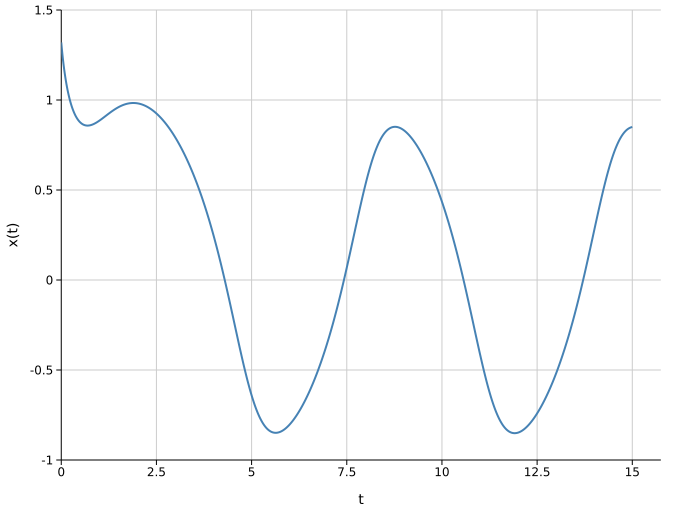
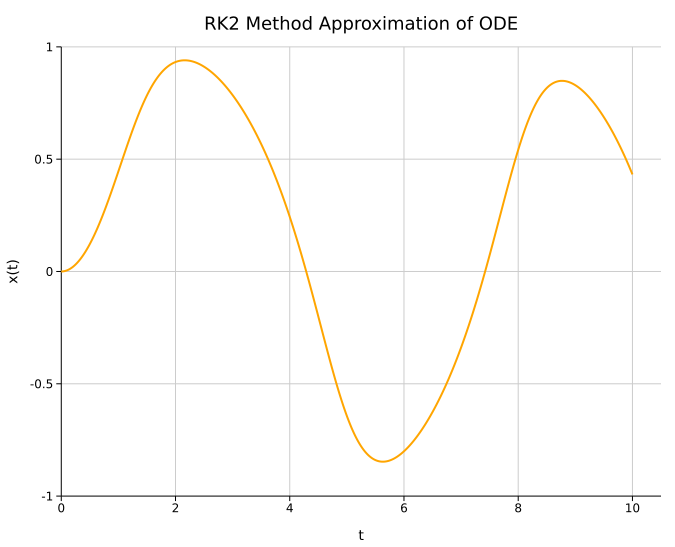
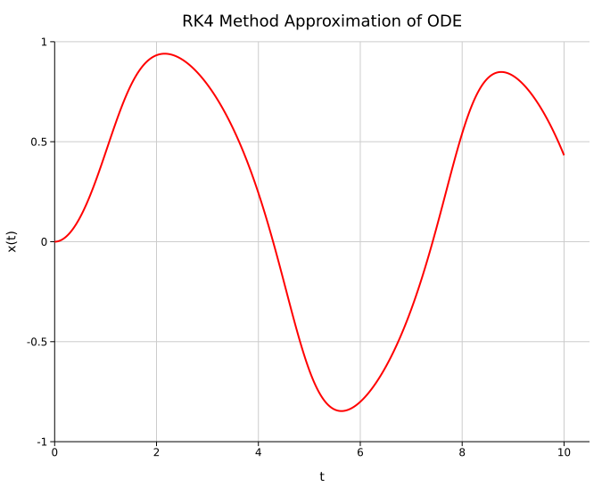
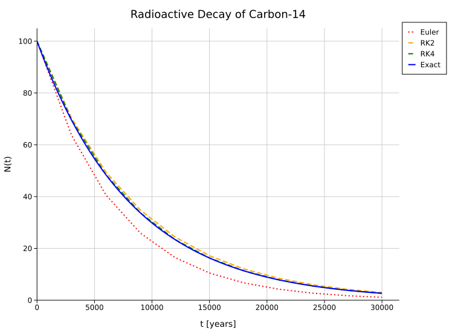

# First-Order ODEs in One Independent Variable

\\[ \frac{dx}{dt}  = f(x, t) \\]

## Euler Method

```rust
use std::time::Instant;

fn euler<F>(function: F, initial: f64, a: f64, b: f64, n: usize,) -> Vec<(f64, f64)> 
where
    F: Fn(f64, f64) -> f64
{
    assert!(n > 0, "n must be greater than 0");

    let h: f64 = (b - a) / n as f64;

    let t_points: Vec<f64> = (0..=n)
        .map(|i| a + i as f64 * h)
        .collect();
    
    let mut x_points: Vec<f64> = Vec::with_capacity(n + 1);

    let mut x : f64 = initial;

    for t in t_points.iter() {
        x_points.push(x);
        x += h * function(x, *t)
    }
    
    t_points.into_iter().zip(x_points).collect()
}

fn main() {
    let function = |x: f64, t: f64| - x.powi(3) + t.sin();

    let start = Instant::now();
    let data: Vec<(f64, f64)> = euler(function, 0.0, 0.0, 10.0, 1000);
    let end = start.elapsed();

    println!("Euler Method took {} microseconds.", end.as_micros());
}
```




## Runge-Kutta Methods

### Order 2
```rust
use std::time::Instant;

fn rk2<F>(function: F, initial: f64, a: f64, b: f64, n: usize,) -> Vec<(f64, f64)> 
where
    F: Fn(f64, f64) -> f64
{
    assert!(n > 0, "n must be greater than 0");

    let h: f64 = (b - a) / n as f64;

    let t_points: Vec<f64> = (0..=n)
        .map(|i| a + i as f64 * h)
        .collect();
    
    let mut x_points: Vec<f64> = Vec::with_capacity(n + 1);

    let mut x : f64 = initial;

    for t in t_points.iter() {
        x_points.push(x);
        let k1: f64 = h * function(x, *t);
        let k2: f64 = h * function(x + k1 / 2.0, *t + h / 2.0);
        x += k2
    }
    
    t_points.into_iter().zip(x_points).collect()
}

fn main() {
    let function = |x: f64, t: f64| - x.powi(3) + t.sin();

    let start = Instant::now();
    let data: Vec<(f64, f64)> = rk2(function, 0.0, 0.0, 10.0, 1000);
    let end = start.elapsed();

    println!("RK2 Method took {} microseconds.", end.as_micros());
}
```


### Order 4

```rust
use std::time::Instant;

fn rk4<F>(function: F, initial: f64, a: f64, b: f64, n: usize,) -> Vec<(f64, f64)> 
where
    F: Fn(f64, f64) -> f64
{
    assert!(n > 0, "n must be greater than 0");

    let h: f64 = (b - a) / n as f64;

    let t_points: Vec<f64> = (0..=n)
        .map(|i| a + i as f64 * h)
        .collect();
    
    let mut x_points: Vec<f64> = Vec::with_capacity(n + 1);

    let mut x : f64 = initial;

    for t in t_points.iter() {
        x_points.push(x);
        let k1: f64 = h * function(x, *t);
        let k2: f64 = h * function(x + k1 / 2.0, *t + h / 2.0);
        let k3: f64 = h * function(x + k2 / 2.0, *t + h / 2.0);
        let k4: f64 = h * function(x + k3, *t + h);
        x += (k1 + 2.0 * k2 +2.0 * k3 + k4) / 6.0;
    }
    
    t_points.into_iter().zip(x_points).collect()
}

fn main() {
    let function = |x: f64, t: f64| - x.powi(3) + t.sin();

    let start = Instant::now();
    let data: Vec<(f64, f64)> = rk4(function, 0.0, 0.0, 10.0, 1000);
    let end = start.elapsed();

    println!("RK4 Method took {} microseconds.", end.as_micros());
}
```


## Radioactive Decay
Radioactive decay is described by the differential equation

\\[ \frac{dN}{dt}  = - \lambda N \\]

where \\(N(t)\\) is the amount of radioactive material at time \\(t\\), and \\(\lambda > 0\\) is the decay constant. Given the initial condition \\(N(0)=N_0\\), its exact solution is

\\[ N(t) = N_0 e^{-\lambda t} \\]

```rust
# use std::time::Instant;
# 
# fn euler<F>(function: F, initial: f64, a: f64, b: f64, n: usize,) -> Vec<(f64, f64)> 
# where
    # F: Fn(f64, f64) -> f64
# {
    # assert!(n > 0, "n must be greater than 0");
# 
    # let h: f64 = (b - a) / n as f64;
# 
    # let t_points: Vec<f64> = (0..=n)
        # .map(|i| a + i as f64 * h)
        # .collect();
#     
    # let mut x_points: Vec<f64> = Vec::with_capacity(n + 1);
# 
    # let mut x : f64 = initial;
# 
    # for t in t_points.iter() {
        # x_points.push(x);
        # x += h * function(x, *t)
    # }
#     
    # t_points.into_iter().zip(x_points).collect()
# }
# 
# fn rk2<F>(function: F, initial: f64, a: f64, b: f64, n: usize,) -> Vec<(f64, f64)> 
# where
    # F: Fn(f64, f64) -> f64
# {
    # assert!(n > 0, "n must be greater than 0");
# 
    # let h: f64 = (b - a) / n as f64;
# 
    # let t_points: Vec<f64> = (0..=n)
        # .map(|i| a + i as f64 * h)
        # .collect();
#     
    # let mut x_points: Vec<f64> = Vec::with_capacity(n + 1);
# 
    # let mut x : f64 = initial;
# 
    # for t in t_points.iter() {
        # x_points.push(x);
        # let k1: f64 = h * function(x, *t);
        # let k2: f64 = h * function(x + k1 / 2.0, *t + h / 2.0);
        # x += k2
    # }
#     
    # t_points.into_iter().zip(x_points).collect()
# }
# fn rk4<F>(function: F, initial: f64, a: f64, b: f64, n: usize,) -> Vec<(f64, f64)> 
# where
    # F: Fn(f64, f64) -> f64
# {
    # assert!(n > 0, "n must be greater than 0");
# 
    # let h: f64 = (b - a) / n as f64;
# 
    # let t_points: Vec<f64> = (0..=n)
        # .map(|i| a + i as f64 * h)
        # .collect();
#     
    # let mut x_points: Vec<f64> = Vec::with_capacity(n + 1);
# 
    # let mut x : f64 = initial;
# 
    # for t in t_points.iter() {
        # x_points.push(x);
        # let k1: f64 = h * function(x, *t);
        # let k2: f64 = h * function(x + k1 / 2.0, *t + h / 2.0);
        # let k3: f64 = h * function(x + k2 / 2.0, *t + h / 2.0);
        # let k4: f64 = h * function(x + k3, *t + h);
        # x += (k1 + 2.0 * k2 +2.0 * k3 + k4) / 6.0;
    # }
#     
    # t_points.into_iter().zip(x_points).collect()
# }
#
fn main() {
    // Carbon-14 (¹⁴C) radioactive decay.
    // Its half-life is approximately 5,730 years.
    let initial: f64 = 100.0;
    let half_life: f64 = 5730.0; // years
    let lambda = 2.0_f64.ln() / half_life; // per year

    let decay = |n: f64, _t: f64| -lambda * n;
    let exact_solution = |t: f64| initial * (-lambda * t).exp();

    let start_euler = Instant::now();
    let data_euler = euler(decay, initial, 0.0, 30_000.0, 10);
    let elapsed_euler = start_euler.elapsed();

    let start_rk2 = Instant::now();
    let data_rk2 = rk2(decay, initial, 0.0, 30_000.0, 10);
    let elapsed_rk2 = start_euler.elapsed();

    let start_rk4 = Instant::now();
    let data_rk4 = rk4(decay, initial, 0.0, 30_000.0, 10);
    let elapsed_rk4 = start_euler.elapsed();

    println!("Euler Method took {} microseconds.", elapsed_euler.as_micros());
    println!("RK2 Method took {} microseconds.", elapsed_rk2.as_micros());
    println!("RK4 Method took {} microseconds.", elapsed_rk4.as_micros());
}
```

