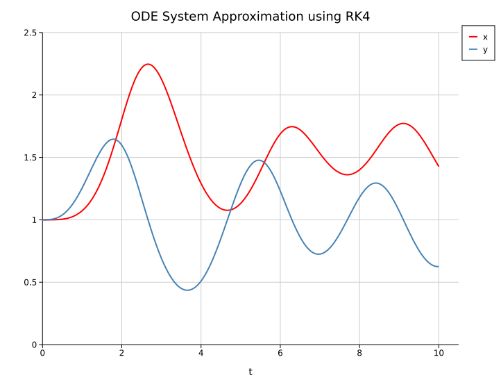
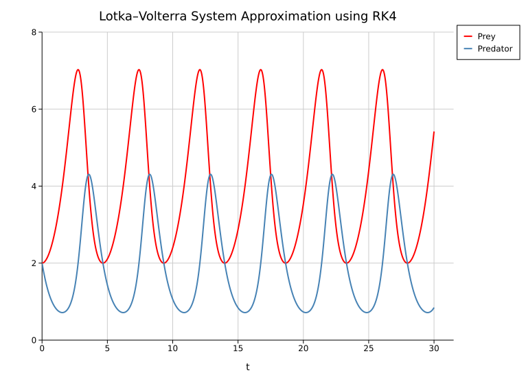

# First-Order Systems of ODEs

\\[ \frac{dx}{dt}  = f_x(x, y, t) \\]
\\[ \frac{dy}{dt}  = f_y(x, y, t) \\]

```rust
use std::time::Instant;

fn rk4<F>(system: F, mut r: Vec<f64>, a: f64, b: f64, n: usize,) -> (Vec<(f64, f64)>, Vec<(f64, f64)>)
where
    F: Fn(&[f64], f64) -> Vec<f64>
{
    assert!(n > 0, "n must be greater than 0");

    let h: f64 = (b - a) / n as f64;

    let t_points: Vec<f64> = (0..=n)
        .map(|i| a + i as f64 * h)
        .collect();
    
    let mut x_points: Vec<(f64, f64)> = Vec::with_capacity(n + 1);
    let mut y_points: Vec<(f64, f64)> = Vec::with_capacity(n + 1);

    for t in t_points.iter() {
        x_points.push((*t, r[0]));
        y_points.push((*t, r[1]));

        let k1: Vec<f64> = system(&r, *t).iter().map(|derivative| h * derivative).collect();

        let values_k2: Vec<f64> = r.iter().zip(&k1).map(|(x, k)| x + k / 2.0).collect();
        let k2: Vec<f64> = system(&values_k2, *t + h / 2.0).iter().map(|derivative| h * derivative).collect();

        let values_k3: Vec<f64> = r.iter().zip(&k2).map(|(x, k)| x + k / 2.0).collect();
        let k3: Vec<f64> = system(&values_k3, *t + h / 2.0).iter().map(|derivative| h * derivative).collect();

        let values_k4: Vec<f64> = r.iter().zip(&k3).map(|(x, k)| x + k).collect();
        let k4: Vec<f64> = system(&values_k4, *t + h).iter().map(|derivative| h * derivative).collect();

        r.iter_mut().enumerate().for_each(|(j, value)| *value += (k1[j] + 2.0 * k2[j] + 2.0 * k3[j] + k4[j]) / 6.0);
    }
    
    (x_points, y_points)
}

fn main() {
    let system = |state: &[f64], t: f64| -> Vec<f64> {
        let x = state[0]; // prey population
        let y = state[1]; // predator population

        vec![
            x * y - x,
            y - x * y + t.sin().powi(2),
        ]
    };

    let start = Instant::now();
    let (x_data, y_data) = rk4(system, vec![1.0, 1.0], 0.0, 10.0, 1000);
    let end = start.elapsed();

    println!("RK4 Method took {} microseconds.", end.as_micros());
}
```


## Lokta-Volterra System
\\[ \frac{dx}{dt}  = \alpha x - \beta x y \\]
\\[ \frac{dy}{dt}  =  \gamma xy - \delta y\\]

```rust
use std::time::Instant;

fn rk4<F>(system: F, mut r: Vec<f64>, a: f64, b: f64, n: usize,) -> (Vec<(f64, f64)>, Vec<(f64, f64)>)
where
    F: Fn(&[f64], f64) -> Vec<f64>
{
    assert!(n > 0, "n must be greater than 0");

    let h: f64 = (b - a) / n as f64;

    let t_points: Vec<f64> = (0..=n)
        .map(|i| a + i as f64 * h)
        .collect();
    
    let mut x_points: Vec<(f64, f64)> = Vec::with_capacity(n + 1);
    let mut y_points: Vec<(f64, f64)> = Vec::with_capacity(n + 1);

    for t in t_points.iter() {
        x_points.push((*t, r[0]));
        y_points.push((*t, r[1]));

        let k1: Vec<f64> = system(&r, *t).iter().map(|derivative| h * derivative).collect();

        let values_k2: Vec<f64> = r.iter().zip(&k1).map(|(x, k)| x + k / 2.0).collect();
        let k2: Vec<f64> = system(&values_k2, *t + h / 2.0).iter().map(|derivative| h * derivative).collect();

        let values_k3: Vec<f64> = r.iter().zip(&k2).map(|(x, k)| x + k / 2.0).collect();
        let k3: Vec<f64> = system(&values_k3, *t + h / 2.0).iter().map(|derivative| h * derivative).collect();

        let values_k4: Vec<f64> = r.iter().zip(&k3).map(|(x, k)| x + k).collect();
        let k4: Vec<f64> = system(&values_k4, *t + h).iter().map(|derivative| h * derivative).collect();

        r.iter_mut().enumerate().for_each(|(j, value)| *value += (k1[j] + 2.0 * k2[j] + 2.0 * k3[j] + k4[j]) / 6.0);
    }
    
    (x_points, y_points)
}

fn main() {
    let alpha = 1.0;
    let beta = 0.5;
    let gamma = 0.5;
    let delta = 2.0;

    let system = |state: &[f64], _t: f64| -> Vec<f64> {
        let x = state[0]; // prey population
        let y = state[1]; // predator population

        vec![
            alpha * x - beta * x * y,
            gamma * x * y - delta * y,
        ]
    };

    let start = Instant::now();
    let (prey_data, predator_data) = rk4(system, vec![2.0, 2.0], 0.0, 30.0, 1000);
    let end = start.elapsed();

    println!("RK4 Method took {} microseconds.", end.as_micros());
}
```

