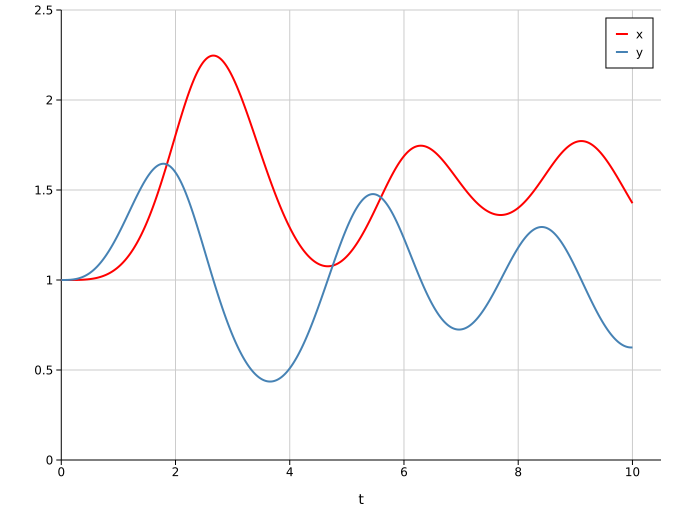
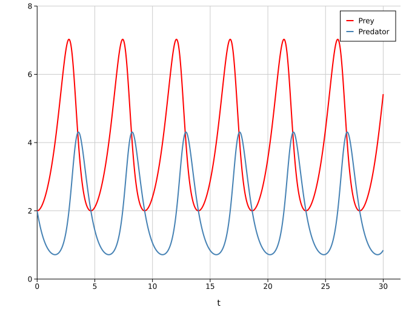

# First-Order Systems of ODEs
We now consider the case of multiple dependent variables that depend on the same parameter, called the independent variable. In general, we will treat this parameter as time. Specifically, we have a system of ordinary differential equations with two dependent variables, $x(t)$ and $y(t)$, which are functions of $t$.

$$
\frac{dx}{dt}  = f_x(t, x, y)
$$

$$
\frac{dy}{dt}  = f_y(t, x ,y)
$$ 

The functions $f_x$ and $f_y$ may be linear or nonlinear in $x$ and $y$.

These equations can be implemented directly using a vector data type:


**Example: Applying RK4 Method to a first-Order systems of ODE**

Given the system of differential equations
$$
\frac{dx}{dt}  = xy-x
$$

$$
\frac{dy}{dt} = y - xy + \sin(\omega t)^2
$$

with $\omega = 1$, find its solution on the interval $t \in [0,10]$, subject to the initial conditions $x(0)=y(0)=1$.
```rust
# use std::time::Instant;
# 
# fn rk4<F>(system: F, mut r: Vec<f64>, a: f64, b: f64, n: usize,) -> (Vec<(f64, f64)>, Vec<(f64, f64)>)
# where
    # F: Fn(&[f64], f64) -> Vec<f64>
# {
    # assert!(n > 0, "n must be greater than 0");
# 
    # let h: f64 = (b - a) / n as f64;
# 
    # let t_points: Vec<f64> = (0..=n)
        # .map(|i| a + i as f64 * h)
        # .collect();
#     
    # let mut x_points: Vec<(f64, f64)> = Vec::with_capacity(n + 1);
    # let mut y_points: Vec<(f64, f64)> = Vec::with_capacity(n + 1);
# 
    # for t in t_points.iter() {
        # x_points.push((*t, r[0]));
        # y_points.push((*t, r[1]));
# 
        # let k1: Vec<f64> = system(&r, *t).iter().map(|derivative| h * derivative).collect();
# 
        # let values_k2: Vec<f64> = r.iter().zip(&k1).map(|(x, k)| x + k / 2.0).collect();
        # let k2: Vec<f64> = system(&values_k2, *t + h / 2.0).iter().map(|derivative| h * derivative).collect();
# 
        # let values_k3: Vec<f64> = r.iter().zip(&k2).map(|(x, k)| x + k / 2.0).collect();
        # let k3: Vec<f64> = system(&values_k3, *t + h / 2.0).iter().map(|derivative| h * derivative).collect();
# 
        # let values_k4: Vec<f64> = r.iter().zip(&k3).map(|(x, k)| x + k).collect();
        # let k4: Vec<f64> = system(&values_k4, *t + h).iter().map(|derivative| h * derivative).collect();
# 
        # r.iter_mut().enumerate().for_each(|(j, value)| *value += (k1[j] + 2.0 * k2[j] + 2.0 * k3[j] + k4[j]) / 6.0);
    # }
#     
    # (x_points, y_points)
# }
#
# fn main() {
let system = |state: &[f64], t: f64| -> Vec<f64> {
    let x = state[0]; 
    let y = state[1];
    vec![
        x * y - x,
        y - x * y + t.sin().powi(2),
    ]
};

let start = Instant::now();
let (x_data, y_data) = rk4(system, vec![1.0, 1.0], 0.0, 10.0, 1000);
let end = start.elapsed();

println!("RK4 Method took {} microseconds.", end.as_micros());
# }
```


**Example: Applying RK4 Method to Lokta-Volterra System**

The Lotka–Volterra equations are a mathematical model used to describe predator–prey systems.

Let $x$ and $y$ represent the populations of two species, often described as rabbits and foxes. In this model, rabbits reproduce at a rate proportional to their population and are preyed upon at a rate proportional to the product of the rabbit and fox populations:

$$
\frac{dx}{dt}  = \alpha x - \beta x y
$$
where $\alpha$ and $\beta$ are positive constants.

Similarly, the fox population grows through encounters with rabbits and declines at a rate proportional to its own population. The second equation is

$$
\frac{dy}{dt}  =  \gamma xy - \delta y
$$

where $\gamma$ and $\delta$ are positive constants.

with $\alpha = 1$,  $\beta = \gamma = 0.5$ and $\delta=2$, find its solution on the interval $t \in [0,30]$, subject to the initial conditions $x(0)=y(0)=2$.
```rust
# use std::time::Instant;
# 
# fn rk4<F>(system: F, mut r: Vec<f64>, a: f64, b: f64, n: usize,) -> (Vec<(f64, f64)>, Vec<(f64, f64)>)
# where
    # F: Fn(&[f64], f64) -> Vec<f64>
# {
    # assert!(n > 0, "n must be greater than 0");
# 
    # let h: f64 = (b - a) / n as f64;
# 
    # let t_points: Vec<f64> = (0..=n)
        # .map(|i| a + i as f64 * h)
        # .collect();
#     
    # let mut x_points: Vec<(f64, f64)> = Vec::with_capacity(n + 1);
    # let mut y_points: Vec<(f64, f64)> = Vec::with_capacity(n + 1);
# 
    # for t in t_points.iter() {
        # x_points.push((*t, r[0]));
        # y_points.push((*t, r[1]));
# 
        # let k1: Vec<f64> = system(&r, *t).iter().map(|derivative| h * derivative).collect();
# 
        # let values_k2: Vec<f64> = r.iter().zip(&k1).map(|(x, k)| x + k / 2.0).collect();
        # let k2: Vec<f64> = system(&values_k2, *t + h / 2.0).iter().map(|derivative| h * derivative).collect();
# 
        # let values_k3: Vec<f64> = r.iter().zip(&k2).map(|(x, k)| x + k / 2.0).collect();
        # let k3: Vec<f64> = system(&values_k3, *t + h / 2.0).iter().map(|derivative| h * derivative).collect();
# 
        # let values_k4: Vec<f64> = r.iter().zip(&k3).map(|(x, k)| x + k).collect();
        # let k4: Vec<f64> = system(&values_k4, *t + h).iter().map(|derivative| h * derivative).collect();
# 
        # r.iter_mut().enumerate().for_each(|(j, value)| *value += (k1[j] + 2.0 * k2[j] + 2.0 * k3[j] + k4[j]) / 6.0);
    # }
#     
    # (x_points, y_points)
# }
#
# fn main() {
let alpha = 1.0;
let beta = 0.5;
let gamma = 0.5;
let delta = 2.0;

let system = |state: &[f64], _t: f64| -> Vec<f64> {
    let x = state[0]; // prey population
    let y = state[1]; // predator population
    vec![
        alpha * x - beta * x * y,
        gamma * x * y - delta * y,
    ]
};

let start = Instant::now();
let (prey_data, predator_data) = rk4(system, vec![2.0, 2.0], 0.0, 30.0, 1000);
let end = start.elapsed();

println!("RK4 Method took {} microseconds.", end.as_micros());
# }
```

