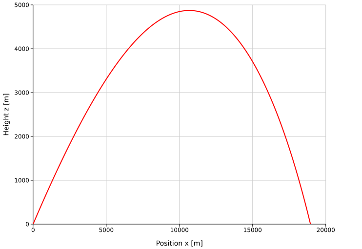
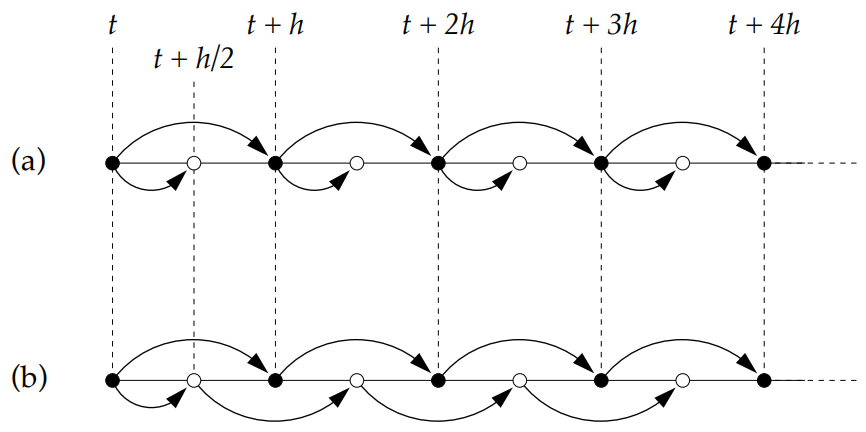
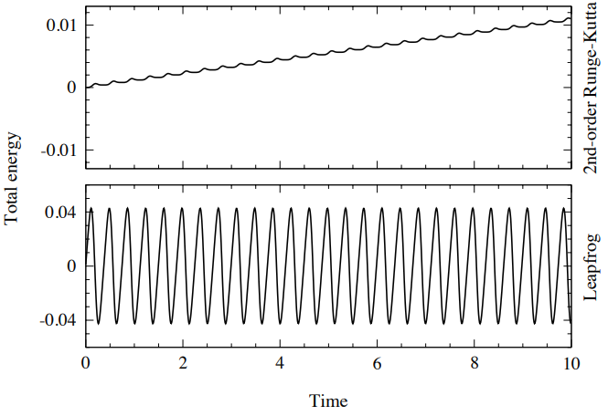
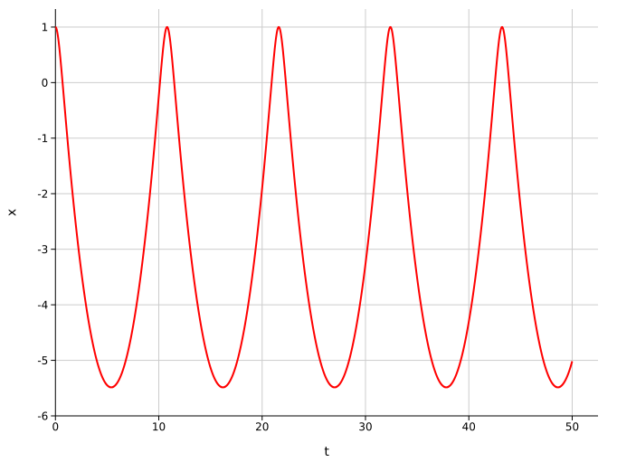

# **Multistep Methods**
The Euler method is a one-step method: given $x(t)$, it directly estimates the solution at $x(t+h)$. Runge–Kutta methods use intermediate steps to obtain a more accurate estimate at $x(t+h)$. However, this intermediate information is discarded before the next step.

Multistep methods aim to retain the efficiency of Runge–Kutta methods by reusing information from previous steps instead of discarding it. In general, multistep methods involve equations that relate the solution values at several points to the values of their derivatives.

**Advantages:**
- Fewer calculations per step, which can make the method faster

**Disadvantages**:
- They need several initial solution values before they can get started
- Their formulas are more complicated
- Changing the step size is more complicated.

A common approach is to combine a Runge–Kutta method with a multistep method. As an analogy, think of the multistep method as a diesel engine that can carry us efficiently over a long distance. To get moving, though, it needs a starter motor to provide the first few points. A method such as fourth-order Runge–Kutta (RK4) can provide those initial values.


## **Adam-Bashford Family of Explicit Methods**
The key starting point is the Fundamental Theorem of Calculus, which states that differentiation and integration are inverse operations:

$$
y_{n+1}-y_n = \int_{t_n}^{t_{n+1}} y'(t)\,dt = \int_{t_n}^{t_{n+1}} f(t, y)\,dt
$$

The idea is to approximate $f(t,y(t))$ with an interpolating polynomial. Since polynomials are easy to integrate, we can integrate this approximation to estimate $y_{n+1}$.

An interpolating polynomial through $n+1$ data points can be constructed using either the Lagrange form or the Newton–Gregory form. The Lagrange form is

$$
P(t) = \sum_{k=0}^n f(x_k) L_{n,k}(t)
$$

where

$$
L_{n,k}(t)
=
\prod_{\substack{j=0\\j\ne k}}^{n}
\frac{t-x_j}{x_k-x_j}
$$

Although the Lagrange form is useful, it can be cumbersome to integrate. The Newton–Gregory form is often more convenient because it uses forward and backward differences.

The forward difference is defined by

$$
\Delta P_n=P_{n+1}-P_n
$$

Applying the forward difference repeatedly gives

$$
\Delta^k P_n=\Delta\!\left(\Delta^{k-1}P_n\right)
$$

For example

$$
\Delta^2 P_n
= \Delta P_{n+1}-\Delta P_n
= P_{n+2}-2P_{n+1}+P_n
$$


Similarly, the backward difference is defined by
$$
\nabla P_n=P_n-P_{n-1}
$$

and repeated backward differences are given by

$$
\nabla^k P_n=\nabla\!\left(\nabla^{k-1}P_n\right).
$$

For equally spaced points, the Newton–Gregory interpolating polynomial using forward differences is
$$
P(t)=\sum_{k=0}^{n}\binom{s}{k}\Delta^k f(x_0)
\qquad
t=x_0+hs
$$


where $h$ is the spacing between consecutive points. This form requires forward differences, which may not be available when estimating the next solution value from past data. Instead, we can use backward differences

$$
P(t)=\sum_{k=0}^{n}(-1)^k\binom{-s}{k}\nabla^k f(x_n),
\qquad
t=x_n+hs.
$$


The generalized binomial coefficient satisfies
$$
\binom{-s}{k}
=
(-1)^k\frac{s(s+1)\cdots(s+k-1)}{k!}.
$$

Integrating the interpolating polynomial from $t_n$ to $t_{n+1}=t_n+h$, with $s=(t-t_n)/h$, gives

$$
y_{n+1}
\approx y_n+h\int_0^1 P_{k-1}(s)\,ds.
$$

Substituting the backward-difference form of the polynomial,
$$
y_{n+1}
\approx y_n
+h\sum_{i=0}^{k-1}\gamma_i\nabla^i f_n,
\]
$$

where

$$
\gamma^i = (-1)^i \int^1_0 ds \binom{-s}{i}
$$

For example:

$$
\binom{-s}{0} = 1 \Rightarrow \gamma^0 = \int^1_0 ds = 1 
$$

$$
\binom{-s}{1} = -s \Rightarrow \gamma^1 = \int^1_0 s ds = 1/2 
$$

$$
\binom{-s}{2} = \frac{s(s+1)}{2} \Rightarrow \gamma^2 = 5/12
$$

The first few coefficients are:
| $k$ | $\gamma_k$ |
|---|---|
| 0 | 1 |
| 1| 1/2 |
| 2 | 5/12 |
| 3 | 3/8 |
| 4 |251/720 |
| 5 | 95/288|

This gives the Adams–Bashforth family of methods:

$$

y_{n+1}
= y_n+h\left(
f_n+\frac12\nabla f_n+\frac{5}{12}\nabla^2 f_n+\cdots
\right)
$$

| $k$ | Formula | Method |
|:---:|:---:|:---:|
| 1 | $y_{n+1} = y_n + h f_n$ | Euler |
| 2 | $y_{n+1} = y_n + h/2( 3 f_n- f_{n-1})$  | 2-step Adam-Bashford |
| 3 | $y_{n+1} = y_n + h/12( 23f_n-16f_{n-1}+5f_{n-2})$  | 3-step Adam-Bashford |
| 4 | $y_{n+1} = y_n + h/24( 55f_n-59f_{n-1}+37f_{n-2}-9f_{n-3})$  | 4-step Adam-Bashford |
| 5 | $y_{n+1} = y_n + h/720( 1901f_n-2774f_{n-1}+2616f_{n-2}-1274f_{n-3}+251f_{n-4})$  | 5-step Adam-Bashford |

A $k$-step Adams–Bashforth method uses the $k$ most recent function values. Its local truncation error is $\mathcal{O}(h^{k+1})$.

**Example: Applying the 4-Step Adams–Bashforth Method to Projectile Motion with Air Resistance**

Consider a projectile moving through air whose density varies with altitude according to

$$
\rho(z) = \rho_0 e^{-z/H}
$$
where $\rho_0$ is the air density at sea level and $H$ is the atmospheric scale height.


he projectile’s acceleration is the sum of gravitational acceleration and quadratic drag:
$$
\mathbf{a}
= \mathbf{a}_g + \mathbf{a}_{\text{drag}}
= -g_0\,\hat{\mathbf{z}}
-\frac{1}{2}\frac{\rho(z) C_d A}{m}\,\|\mathbf{v}\|\,\mathbf{v},
$$

where $g_0$ is the gravitational acceleration, $C_d$ is the drag coefficient, $A$ is the projectile’s cross-sectional area, $m$ is its mass, and $\mathbf{v}$ is its velocity.

For this problem, model the projectile as a NATO 155 mm M107 shell with
$$
C_d=0.3,\qquad A=0.0189\ \text{m}^2,\qquad m=43.2\ \text{kg}
$$

Solve the projectile’s equations of motion using the fourth-order Adams–Bashforth method (AB4). Compare the results with those obtained using the fourth-order Runge–Kutta method (RK4). Use the same initial conditions and time step for both methods.

```rust,ignore
use ndarray::{Array1, ArrayView1};
use std::time::Instant;

fn rk4_step<F>(function: &F, t: f64, x: &Array1<f64>, h: f64) -> Array1<f64>
where
    F: Fn(f64, &Array1<f64>) -> Array1<f64>
{
    let k1 = function(t, x);

    let x2 = x + &k1.mapv(|v| v * (h / 2.0));
    let k2 = function(t + h / 2.0, &x2);

    let x3 = x + &k2.mapv(|v| v * (h / 2.0));
    let k3 = function(t + h / 2.0, &x3);

    let x4 = x + &k3.mapv(|v| v * h);
    let k4 = function(t + h, &x4);

    let sum = &k1 + &k2.mapv(|v| 2.0 * v) + &k3.mapv(|v| 2.0 * v) + &k4;

    x + &sum.mapv(|v| v * (h / 6.0))
}

fn rk4<F>(function: F, initial: Array1<f64>, t_0: f64, h: f64) -> Vec<(f64, Array1<f64>)>
where
    F: Fn(f64, &Array1<f64>) -> Array1<f64>
{
    let mut points = Vec::new();
    let mut t = t_0;
    let mut x = initial;

    points.push((t, x.clone()));

    while x[2] >= 0.0 {
        x = rk4_step(&function, t, &x, h);
        t += h;
        points.push((t, x.clone()));
    }

    points
}

fn ab4<F>(function: F, initial: Array1<f64>, t_0: f64, h: f64) -> Vec<(f64, Array1<f64>)>
where
    F: Fn(f64, &Array1<f64>) -> Array1<f64>
{
    let mut points = Vec::new();
    let mut t = t_0;
    let mut x = initial;

    points.push((t, x.clone()));

    // Begin with RK4 to get the first 4 points
    for _ in 0..3 {
        x = rk4_step(&function, t, &x, h);
        t += h;
        points.push((t, x.clone()));
    }

    while x[2] >= 0.0 {
        let f_n = function(t, &x);
        let f_n1 = function(t - h, &points[points.len() -2].1);
        let f_n2 = function(t - 2.0 * h, &points[points.len() -3].1);
        let f_n3 = function(t - 3.0 * h, &points[points.len() -4].1);
        x = &x + &(&f_n.mapv(|v| 55.0 * v) - &f_n1.mapv(|v| 59.0 * v) + &f_n2.mapv(|v| 37.0 * v) - &f_n3.mapv(|v| 9.0 * v)).mapv(|v| v * (h / 24.0));
        t += h;
        points.push((t, x.clone()));
    }

    points
}

const Rho_0: f64 = 1.225; // kg/m^3
const H: f64 = 8500.0; // m
const A: f64 = 0.0189; // m^2
const Cd: f64 = 0.24; // dimensionless
const M: f64 = 43.2; // kg
const G: f64 = 9.80; // m/s^2

fn main() {
    let air_density = |z: f64| Rho_0 * (-z / H).exp();

    let acceleration = |v: ArrayView1<'_, f64>, z: f64| {
        let a_g = Array1::from_vec(vec![0.0, 0.0, -G]);
        let rho = air_density(z);
        let v_norm = v.dot(&v).sqrt();
        let a_d = &v * (-0.5 * rho * A * Cd * v_norm / M);

        a_g + a_d
    };

    // ODE: state = [x, y, z, vx, vy, vz], where (x, y, z) is position and (vx, vy, vz) is velocity
    let ode = |_: f64, state: &Array1<f64>| {
        let position = state.slice(ndarray::s![0..3]);
        let velocity = state.slice(ndarray::s![3..6]);

        Array1::from_vec(vec![
            velocity[0],
            velocity[1],
            velocity[2],
            acceleration(velocity, position[2])[0],
            acceleration(velocity, position[2])[1],
            acceleration(velocity, position[2])[2],
        ])
    };

    // Initial conditions
    let v_0: f64 = 650.0;
    let angle = 38.0_f64.to_radians();

    let initial = Array1::from_vec(vec![
        0.0,                      // x
        0.0,                      // y
        0.0,                      // z
        v_0 * angle.cos(),        // vx
        0.0,                      // vy
        v_0 * angle.sin(),        // vz
    ]);
    
    // Run RK4
    let start_rk4 = Instant::now();
    let points_rk4 = rk4(ode, initial.clone(), 0.0, 0.01);
    let duration_rk4 = start_rk4.elapsed();

    let (t_impact, impact_state) = points_rk4.last().unwrap();

    let max_height = points_rk4
        .iter()
        .map(|(_, state)| state[2])
        .fold(f64::NEG_INFINITY, f64::max);

    let impact_speed = impact_state
        .slice(ndarray::s![3..6])
        .dot(&impact_state.slice(ndarray::s![3..6]))
        .sqrt();

    println!("RK4: ToF = {:.2} s, Range = {:.2} m, Max Height = {:.2} m, Impact Velocity = {:.2} m/s", t_impact, impact_state[0], max_height, impact_speed);

    // Run AB4
    let start_ab4 = Instant::now();
    let points_ab4 = ab4(ode, initial.clone(), 0.0, 0.01);
    let duration_ab4 = start_ab4.elapsed();

    let (t_impact, impact_state) = points_ab4.last().unwrap();

    let max_height = points_ab4
        .iter()
        .map(|(_, state)| state[2])
        .fold(f64::NEG_INFINITY, f64::max);

    let impact_speed = impact_state
        .slice(ndarray::s![3..6])
        .dot(&impact_state.slice(ndarray::s![3..6]))
        .sqrt();

    println!("AB4: ToF = {:.2} s, Range = {:.2} m, Max Height = {:.2} m, Impact Velocity = {:.2} m/s", t_impact, impact_state[0], max_height, impact_speed);
    println!("Computation time: RK4 {} ms, AB4 {} ms",duration_rk4.as_millis(), duration_ab4.as_millis());
    println!("AB4 vs RK4: {}",duration_rk4.as_millis() as f64 / duration_ab4.as_millis() as f64);
}
```



## **Adam-Moulton Family of Implicit Methods**

Adams–Moulton methods are a variant of the Adams–Bashforth methods. They use an interpolating polynomial that passes through one additional point, $(t_{n+1}, f_{n+1})$. Because $(f_{n+1}=f(t_{n+1},y_{n+1})$ depends on the unknown value $y_{n+1}$, these methods are implicit.

| $k$ | Formula | Method |
|:---:|:---:|:---:|
| 1 | $y_{n+1} = y_n + h/2 (f_{n+1} + f_n)$ | 1-step Adam-Moulton  |
| 2 | $y_{n+1} = y_n + h/12( 5 f_{n+1}+8f_n - f_{n-1})$  | 2-step Adam-Moulton  |
| 3 | $y_{n+1} = y_n + h/24( 9 f_{n+1}+19f_n - 5f_{n-1}+ f_{n-2})$   | 3-step Adam-Moulton |


A $k$-step Adams–Moulton method uses $f_{n+1}$ and the \(k\) most recent known function values. Its local truncation error is $\mathcal{O}(h^{k+2})$. These methods are more difficult to implement because evaluating $f_{n+1}=f(t_{n+1},y_{n+1})$ requires knowing the unknown $y_{n+1}$.


## **Leapfrog Method**
The leapfrog method is very similar to Runge-Kutta, but has
certain advantages for certain problems. 

In RK2 we evaluate $x$ half way to wear we want and
then use that to go the full step

$$
x\left(t+\frac{1}{2}h\right)=x(t)+\frac{1}{2}h\,f(x,t)
$$

$$
x(t+h)=x(t)+h\,f\left(x\left(t+\frac{1}{2}h\right),\,t+\frac{1}{2}h\right)
$$

The leapfrog method instead uses the previous half step to
calculate the next $3/2h$ step

$$
x\left(t+\frac{3}{2}h\right)
=
x\left(t+\frac{1}{2}h\right)
+h\,f\bigl(x(t+h),\,t+h\bigr)
$$

$$
x(t+2h)
=
x(t+h)
+h\,f\left(x\left(t+\frac{3}{2}h\right),\,t+\frac{3}{2}h\right)
$$



The top figure shows the Runge-Kutta method (a) where after each step
one uses a half step to calculate the next step. In the leapfrog method (b)
one takes a full step from the starting half step and uses each of those
middle steps to evaluate the full steps.

This method is also second-order, with a global error of $\mathcal{O}(h^2)$ and a local truncation error of $\mathcal{O}(h^3)$. This method can be extended to multiple variables and
functions just like Runge-Kutta and do higher order
derivatives. So the obvious question is what do we gain over
Runge-Kutta by using the leapfrog method.

The leapfrog method has two significant features that make it
interesting:

1. The method is time-reversal symmetric. This can be useful
for physics problems where energy conservation is
important.
2. The error is even in step size $h$, which makes it an ideal
starting point for Richardson extrapolation.

The leapfrog method is time symmetric because if we started
at some point and evaluated forward in time to some $t’$ and
then applied the algorithm in reverse with step size $-h$ we
would end up where we started (aside from rounding error)

This is not true for 2nd order Runge-Kutta, if you perform the
algorithm in reverse each step with have errors of $\mathcal{O}(h^3)$
compared to what you got in the forward direction.

Why is time reversal symmetry important, because if you
have a system that should conserve energy, numerical errors
will cause the energy to drift. But if your solver is time
symmetric, then the energy will be conserved. 

The equations of motion of the pendulum satisfy the conservation of energy.

$$
\frac{d^2\theta}{dt^2} = - \frac{g}{L}\sin\theta 
$$

If we calculate the change in the pendulum’s total energy (kinetic plus potential) as the system evolves over time using the RK2 and leapfrog methods, we obtain somethin similar to this



The RK2 method shows a clear violation of energy conservation. The leapfrog method does not conserve the exact energy either, but its time-reversal symmetry leads to different long-term behavior: energy errors typically oscillate instead of accumulating as a steady drift.

The pendulum’s equations of motion are also invariant under time reversal. In other words, reversing the direction of time reverses the motion. The leapfrog method shares this symmetry, although that does not guarantee that the computed energy will return to exactly the same value after every cycle.

This makes leapfrog useful for studying energy-conserving systems over long time intervals. With RK2, numerical errors can accumulate and cause a simulated pendulum’s amplitude to grow or shrink, or a simulated planetary orbit to drift. Leapfrog usually keeps the energy error bounded, so the simulation can remain qualitatively realistic for much longer.


**Example: Applying Leapfrog Method**

Apply the leapfrog method to the differential equation

$$
\frac{d^2x}{dt^2} = \frac{dx}{dt} ^2 -x -5
$$

find its solution on the interval $t \in [0,50]$, with step $h=0.001$, subject to the initial conditions $x(0)= 1,v(0)=0$.

```rust
use std::time::Instant;

fn leapfrog<F>(system: F, r: Vec<f64>, a: f64, b: f64, h: f64) -> (Vec<(f64, f64)>, Vec<(f64, f64)>)
where
    F: Fn(f64, &[f64]) -> Vec<f64>
{   
    let n = ((b - a) / h).ceil() as usize;
    let t_points: Vec<f64> = (0..n)
        .map(|i| a + i as f64 * h)
        .collect();
    
    let mut x_points: Vec<(f64, f64)> = Vec::new();
    let mut y_points: Vec<(f64, f64)> = Vec::new();

    let mut r1 = r.clone();
    let mut r2: Vec<f64> = r1.iter().zip(system(a, &r1).iter())
        .map(|(value, derivative)| value + h * derivative / 2.0)
        .collect();

    for t in t_points.iter() {
        x_points.push((*t, r1[0]));
        y_points.push((*t, r1[1]));

        r1.iter_mut().zip(system(*t, &r2).iter()).for_each(|(value, derivative)| {
            *value += h * derivative;
        });

        r2.iter_mut().zip(system(*t, &r1).iter()).for_each(|(value, derivative)| {
            *value += h * derivative;
        });
    }
    
    (x_points, y_points)
}

fn main() {
    let system = |_t: f64, state: &[f64]| -> Vec<f64> {
        let x = state[0]; 
        let v = state[1]; 

        vec![
            v,
            v.powi(2) - x - 5.0
        ]
    };

    let start = Instant::now();
    let (x_data, v_data) = leapfrog(system, vec![1.0, 0.0], 0.0, 50.0, 0.001);
    let end = start.elapsed();

    println!("Leapfrog Method took {} microseconds.", end.as_micros());
}
```



## **Verlet Method**
It’s a particular case of the frog-leap method for studying the equations of motion of a physical system. Let the equation of motion be:

$$
\frac{d^2x}{dt^2} = f(t, x)
$$

Instead of treating them as a vector system, let us apply the leapfrog method to each equation separately.

$$
x(t+h)=x(t)+h\,v\left(t+\frac{h}{2}\right)
$$

$$
v\left(t+\frac{3h}{2}\right)
=
v\left(t+\frac{h}{2}\right)
+h\,f\bigl(x(t+h),\,t+h\bigr)
$$

Notice that $x$ only depends on integer $h$ while $v$ only depends
on $1/2$ integer $h$. So in this case that is an improvement over
the vector method.

This simplification only works for equations of motion or
differential equations that have this special structure where the
right-hand side of the first equation depends on $v$ but not on $x$
and the right-hand side of the second equation depends on $x$
and not on $v$. This situation is not unusual in physics. 

One minor problem is that if you want to calculate some
quantity the depends $x$ and $v$ like potential energy you don’t
know both of them at the same step. You can however calculate
$v(t+h)$ from $v(t+h/2)$ like this.

$$
v(t+h)=v\left(t+\frac{1}{2}h\right)+\frac{1}{2}h\,f\bigl(x(t+h),\,t+h\bigr)
$$

Putting the equations
together one gets:

$$
r(t+h) = r(t)+h\,v\left(t+\frac{1}{2}h\right)
$$

$$
k = h\,f\bigl(r(t+h),\,t+h\bigr)
$$

$$
v(t+h) = v\left(t+\frac{1}{2}h\right)+\frac{1}{2}k,\\
$$

$$
v\left(t+\frac{3}{2}h\right) = v\left(t+\frac{1}{2}h\right)+k.
$$

The 3rd equation is only needed if you want to know both $r$
and $v$ at $t+h$. And of course $t+3/2h = t’ + 1/2h$ so one can
keep stepping forward

**Example: Applying Verlet Method to the Orbit of the Earth**

The
equations of motion for the position
$r=(x,y)$ of the Earth around the Sun are the same as
those for any orbiting body. In vector
form they are :

$$
\frac{d^2\mathbf{r}}{dt^2}=-\frac{GM}{r^3}\mathbf{r},
$$

where $G$ is Newton’s universal gravitational constant and $M$ is the mass of the Sun.

The orbit of the Earth is not perfectly
circular. When it is at closet point it is
moving precisely tangentially at a
distance of $1.4710 \times 10^{11}\,\text{[m]}$ with a velocity
of $3.0287 \times 10^{4}\,\text{[m/s]}$

Calculate the orbit of
the Earth using the Verlet method with a
time step of $h=1\,\text{[hour]}$. Make a plot of the
orbit for several complete revolutions.

Calculate the gravitational potential energy of the
Earth $-GMm/r$ and it’s kinetic energy $1/2mv^2$. Plot the three energies
as a function of time. You should find
that the potential and kinetic energy vary
visibly during the course of an orbit, but
the total energy remains constant.

Now plot the total energy alone without
the others and you should be able to see
a slight variation over the course of an
orbit. Because you are using the Verlet
method, however, which conserves
energy in the long term, the energy
should always return to its starting
value.
