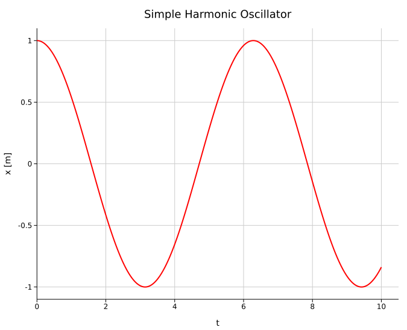
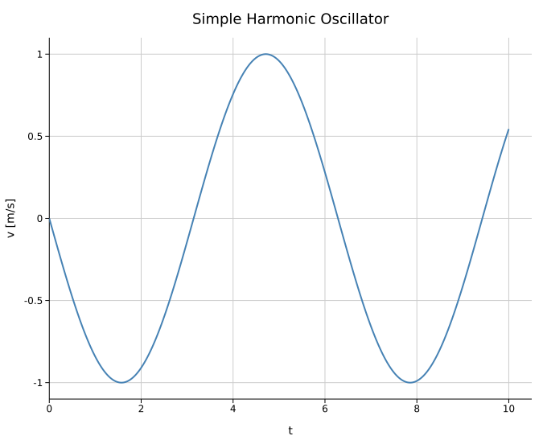
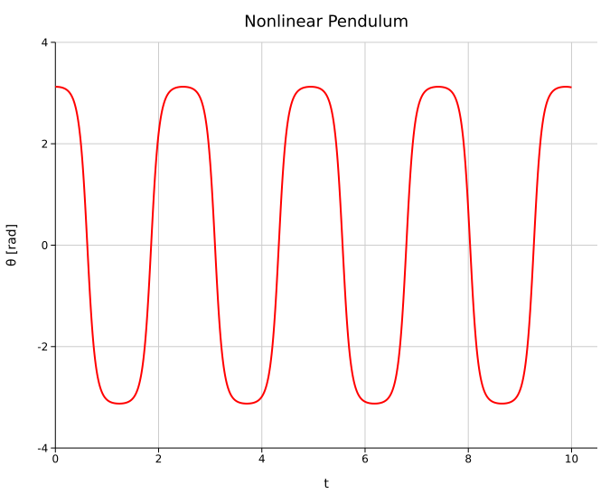
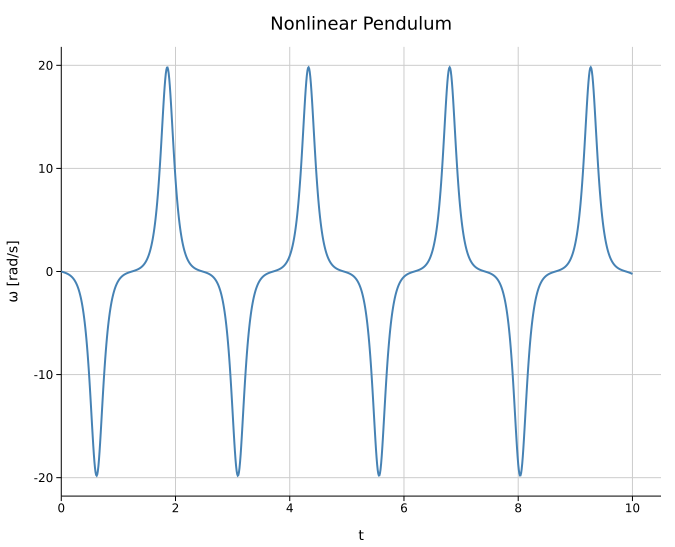
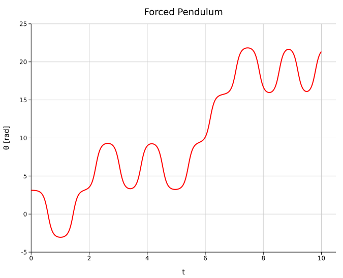
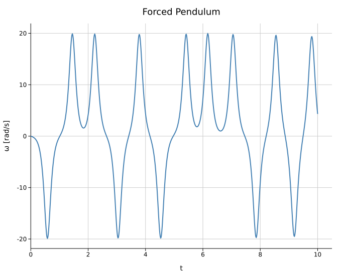

# Second-Order ODEs in One Independent Variable

\\[ \frac{d²x}{dt²}  = f(x, x', t) \\]

Could be written as 

\\[ \frac{dx}{dt}  = y \\]
\\[ \frac{dy}{dt}  = f(x, y, t) \\]

## Simple Harmonic Oscillator

\\[ \frac{d^2x}{dt^2} = - \omega² x \\]

Rewrite as

\\[ \frac{dx}{dt} = v \\]
\\[ \frac{dv}{dt} = - \omega² x \\]

```rust
use std::time::Instant;

fn rk4<F>(system: F, mut r: Vec<f64>, a: f64, b: f64, n: usize,) -> (Vec<(f64, f64)>, Vec<(f64, f64)>)
where
    F: Fn(&[f64], f64) -> Vec<f64>
{
    assert!(n > 0, "n must be greater than 0");

    let h: f64 = (b - a) / n as f64;

    let t_points: Vec<f64> = (0..=n)
        .map(|i| a + i as f64 * h)
        .collect();
    
    let mut x_points: Vec<(f64, f64)> = Vec::with_capacity(n + 1);
    let mut y_points: Vec<(f64, f64)> = Vec::with_capacity(n + 1);

    for t in t_points.iter() {
        x_points.push((*t, r[0]));
        y_points.push((*t, r[1]));

        let k1: Vec<f64> = system(&r, *t).iter().map(|derivative| h * derivative).collect();

        let values_k2: Vec<f64> = r.iter().zip(&k1).map(|(x, k)| x + k / 2.0).collect();
        let k2: Vec<f64> = system(&values_k2, *t + h / 2.0).iter().map(|derivative| h * derivative).collect();

        let values_k3: Vec<f64> = r.iter().zip(&k2).map(|(x, k)| x + k / 2.0).collect();
        let k3: Vec<f64> = system(&values_k3, *t + h / 2.0).iter().map(|derivative| h * derivative).collect();

        let values_k4: Vec<f64> = r.iter().zip(&k3).map(|(x, k)| x + k).collect();
        let k4: Vec<f64> = system(&values_k4, *t + h).iter().map(|derivative| h * derivative).collect();

        r.iter_mut().enumerate().for_each(|(j, value)| *value += (k1[j] + 2.0 * k2[j] + 2.0 * k3[j] + k4[j]) / 6.0);
    }
    
    (x_points, y_points)
}

fn main() {
    let omega: f64 = 1.0;

    let system = |state: &[f64], _t: f64| -> Vec<f64> {
        let x = state[0]; 
        let v = state[1]; 

        vec![
            v,
            -omega.powi(2) * x
        ]
    };

    let start = Instant::now();
    let (x_data, v_data) = rk4(system, vec![1.0, 0.0], 0.0, 10.0, 1000);
    let end = start.elapsed();

    println!("RK4 Method took {} microseconds.", end.as_micros());
}
```





## Nonlinear Pendulum

\\[ \frac{d^2\theta}{dt^2} = - \frac{g}{L}\sin(\theta) \\]

Rewrite as

\\[ \frac{d\theta}{dt} = \omega \\]
\\[ \frac{d\omega}{dt} = - \frac{g}{L}\sin(\theta) \\]

```rust
use std::time::Instant;

fn rk4<F>(system: F, mut r: Vec<f64>, a: f64, b: f64, n: usize,) -> (Vec<(f64, f64)>, Vec<(f64, f64)>)
where
    F: Fn(&[f64], f64) -> Vec<f64>
{
    assert!(n > 0, "n must be greater than 0");

    let h: f64 = (b - a) / n as f64;

    let t_points: Vec<f64> = (0..=n)
        .map(|i| a + i as f64 * h)
        .collect();
    
    let mut x_points: Vec<(f64, f64)> = Vec::with_capacity(n + 1);
    let mut y_points: Vec<(f64, f64)> = Vec::with_capacity(n + 1);

    for t in t_points.iter() {
        x_points.push((*t, r[0]));
        y_points.push((*t, r[1]));

        let k1: Vec<f64> = system(&r, *t).iter().map(|derivative| h * derivative).collect();

        let values_k2: Vec<f64> = r.iter().zip(&k1).map(|(x, k)| x + k / 2.0).collect();
        let k2: Vec<f64> = system(&values_k2, *t + h / 2.0).iter().map(|derivative| h * derivative).collect();

        let values_k3: Vec<f64> = r.iter().zip(&k2).map(|(x, k)| x + k / 2.0).collect();
        let k3: Vec<f64> = system(&values_k3, *t + h / 2.0).iter().map(|derivative| h * derivative).collect();

        let values_k4: Vec<f64> = r.iter().zip(&k3).map(|(x, k)| x + k).collect();
        let k4: Vec<f64> = system(&values_k4, *t + h).iter().map(|derivative| h * derivative).collect();

        r.iter_mut().enumerate().for_each(|(j, value)| *value += (k1[j] + 2.0 * k2[j] + 2.0 * k3[j] + k4[j]) / 6.0);
    }
    
    (x_points, y_points)
}

fn main() {
    let g: f64 = 9.81;
    let l: f64 = 0.1;

    let system = |state: &[f64], _t: f64| -> Vec<f64> {
        let theta = state[0]; 
        let omega = state[1]; 

        vec![
            omega,
            -(g / l) * theta.sin()
        ]
    };

    let start = Instant::now();
    let pi = std::f64::consts::PI;
    let (theta_data, omega_data) = rk4(system, vec![pi * 179.0/180.0, 0.0], 0.0, 10.0, 1000);
    let end = start.elapsed();

    println!("RK4 Method took {} microseconds.", end.as_micros());
}
```





## Forced Pendulum

\\[ \frac{d^2\theta}{dt^2} = - \frac{g}{L}\sin(\theta) + C cos \theta sin \Omega t \\]

Rewrite as

\\[ \frac{d\theta}{dt} = \omega \\]
\\[ \frac{d\omega}{dt} = - \frac{g}{L}\sin(\theta) + C cos \theta sin \Omega t \\]

```rust
use std::time::Instant;

fn rk4<F>(system: F, mut r: Vec<f64>, a: f64, b: f64, n: usize,) -> (Vec<(f64, f64)>, Vec<(f64, f64)>)
where
    F: Fn(&[f64], f64) -> Vec<f64>
{
    assert!(n > 0, "n must be greater than 0");

    let h: f64 = (b - a) / n as f64;

    let t_points: Vec<f64> = (0..=n)
        .map(|i| a + i as f64 * h)
        .collect();
    
    let mut x_points: Vec<(f64, f64)> = Vec::with_capacity(n + 1);
    let mut y_points: Vec<(f64, f64)> = Vec::with_capacity(n + 1);

    for t in t_points.iter() {
        x_points.push((*t, r[0]));
        y_points.push((*t, r[1]));

        let k1: Vec<f64> = system(&r, *t).iter().map(|derivative| h * derivative).collect();

        let values_k2: Vec<f64> = r.iter().zip(&k1).map(|(x, k)| x + k / 2.0).collect();
        let k2: Vec<f64> = system(&values_k2, *t + h / 2.0).iter().map(|derivative| h * derivative).collect();

        let values_k3: Vec<f64> = r.iter().zip(&k2).map(|(x, k)| x + k / 2.0).collect();
        let k3: Vec<f64> = system(&values_k3, *t + h / 2.0).iter().map(|derivative| h * derivative).collect();

        let values_k4: Vec<f64> = r.iter().zip(&k3).map(|(x, k)| x + k).collect();
        let k4: Vec<f64> = system(&values_k4, *t + h).iter().map(|derivative| h * derivative).collect();

        r.iter_mut().enumerate().for_each(|(j, value)| *value += (k1[j] + 2.0 * k2[j] + 2.0 * k3[j] + k4[j]) / 6.0);
    }
    
    (x_points, y_points)
}

fn main() {
    let g: f64 = 9.81;
    let l: f64 = 0.1;
    let C: f64 = 2.0;
    let Omega: f64 = 5.0;

    let system = |state: &[f64], t: f64| -> Vec<f64> {
        let theta = state[0]; 
        let omega = state[1]; 

        vec![
            omega,
            -(g / l) * theta.sin() + C * theta.cos() * (Omega * t).sin()
        ]
    };

    let start = Instant::now();
    let (theta_data, omega_data) = rk4(system, vec![0.0, 0.0], 0.0, 100.0, 1000);
    let end = start.elapsed();

    println!("RK4 Method took {} microseconds.", end.as_micros());
}
```




