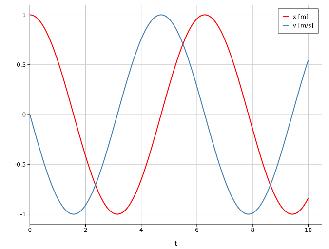
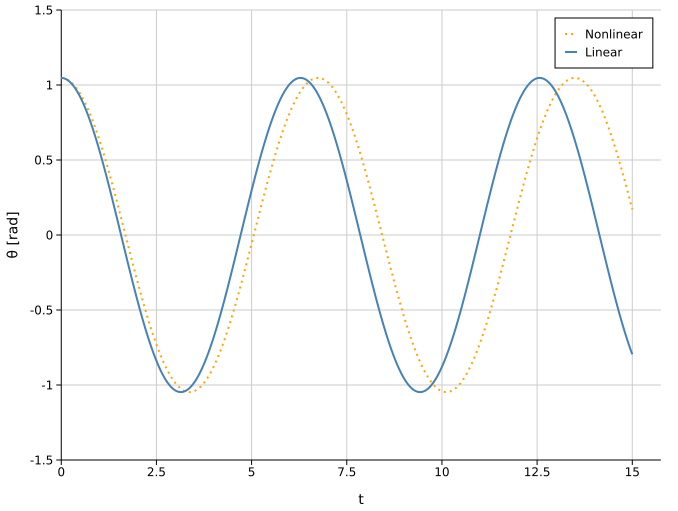
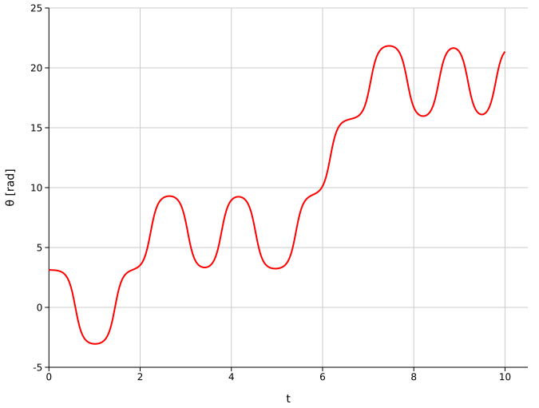

# Second-Order ODEs in One Independent Variable
Many problems in physics involve IVPs whose equations are higher than first order. No new techniques are needed to solve them: by introducing new variables, a higher-order ODE can be rewritten as a system of first-order ODEs. Then, one of the methods discussed earlier can be applied.

The general form of a second-order ODE in one dependent variable is
$$
\frac{d^2x}{dt^2} = f\left(x, x', t\right).
$$

That is, an equation that may involve $x$, its first derivative, and time.

Could be written as:

$$
\frac{dx}{dt}  = y
$$

$$
\frac{dy}{dt}  = f(t, x, y)
$$

**Example: Applying RK4 Method to Simple Harmonic Oscillator**

The equation describing the motion of a simple harmonic oscillator without damping is

$$
\frac{d^2x}{dt^2} = - \omega^2 x
$$

Could be written as:

$$
\frac{dx}{dt} = v
$$

$$
\frac{dv}{dt} = - \omega^2 x 
$$

with $\omega = 1$, find its solution on the interval $t \in [0,10]$, subject to the initial conditions $x(0)= 1,v(0)=0$.

```rust
# use std::time::Instant;
# 
# fn rk4<F>(system: F, mut r: Vec<f64>, a: f64, b: f64, n: usize,) -> (Vec<(f64, f64)>, Vec<(f64, f64)>)
# where
    # F: Fn(&[f64], f64) -> Vec<f64>
# {
    # assert!(n > 0, "n must be greater than 0");
# 
    # let h: f64 = (b - a) / n as f64;
# 
    # let t_points: Vec<f64> = (0..=n)
        # .map(|i| a + i as f64 * h)
        # .collect();
#     
    # let mut x_points: Vec<(f64, f64)> = Vec::with_capacity(n + 1);
    # let mut y_points: Vec<(f64, f64)> = Vec::with_capacity(n + 1);
# 
    # for t in t_points.iter() {
        # x_points.push((*t, r[0]));
        # y_points.push((*t, r[1]));
# 
        # let k1: Vec<f64> = system(&r, *t).iter().map(|derivative| h * derivative).collect();
# 
        # let values_k2: Vec<f64> = r.iter().zip(&k1).map(|(x, k)| x + k / 2.0).collect();
        # let k2: Vec<f64> = system(&values_k2, *t + h / 2.0).iter().map(|derivative| h * derivative).collect();
# 
        # let values_k3: Vec<f64> = r.iter().zip(&k2).map(|(x, k)| x + k / 2.0).collect();
        # let k3: Vec<f64> = system(&values_k3, *t + h / 2.0).iter().map(|derivative| h * derivative).collect();
# 
        # let values_k4: Vec<f64> = r.iter().zip(&k3).map(|(x, k)| x + k).collect();
        # let k4: Vec<f64> = system(&values_k4, *t + h).iter().map(|derivative| h * derivative).collect();
# 
        # r.iter_mut().enumerate().for_each(|(j, value)| *value += (k1[j] + 2.0 * k2[j] + 2.0 * k3[j] + k4[j]) / 6.0);
    # }
#     
    # (x_points, y_points)
# }
#
# fn main() {
let omega: f64 = 1.0;

let system = |state: &[f64], _t: f64| -> Vec<f64> {
    let x = state[0]; 
    let v = state[1]; 
    vec![
        v,
        -omega.powi(2) * x
    ]
};

let start = Instant::now();
let (x_data, v_data) = rk4(system, vec![1.0, 0.0], 0.0, 10.0, 1000);
let end = start.elapsed();

println!("RK4 Method took {} microseconds.", end.as_micros());
# }
```




**Example: Applying RK4 Method to Linear and Nonlinear Pendulum**

The equation of motion for a pendulum is the differential equation

$$
\frac{d^2\theta}{dt^2} = - \frac{g}{L}\sin\theta 
$$

where $g$ is the acceleration due to gravity and $l$ is the length of the pendulum. When $\theta$ is small ,we can rewrite the equation as

$$
\frac{d^2\theta}{dt^2} = - \frac{g}{L}\theta 
$$

We could rewrite the Nonlinear pendulum as

$$
\frac{d\theta}{dt} = \omega
$$

$$
\frac{d\omega}{dt} = - \frac{g}{L}\sin(\theta)
$$

To make things simple, took $l = g$, find the solutions for both the nonlinear and linear pendulum on the interval $t \in [0,15]$, subject to the initial conditions $\theta(0)=60^\circ$ and $\theta'(0)=0$.
```rust
# use std::time::Instant;
# use std::f64::consts::PI;
# 
# fn rk4<F>(system: F, mut r: Vec<f64>, a: f64, b: f64, n: usize,) -> (Vec<(f64, f64)>, Vec<(f64, f64)>)
# where
    # F: Fn(&[f64], f64) -> Vec<f64>
# {
    # assert!(n > 0, "n must be greater than 0");
# 
    # let h: f64 = (b - a) / n as f64;
# 
    # let t_points: Vec<f64> = (0..=n)
        # .map(|i| a + i as f64 * h)
        # .collect();
#     
    # let mut x_points: Vec<(f64, f64)> = Vec::with_capacity(n + 1);
    # let mut y_points: Vec<(f64, f64)> = Vec::with_capacity(n + 1);
# 
    # for t in t_points.iter() {
        # x_points.push((*t, r[0]));
        # y_points.push((*t, r[1]));
# 
        # let k1: Vec<f64> = system(&r, *t).iter().map(|derivative| h * derivative).collect();
# 
        # let values_k2: Vec<f64> = r.iter().zip(&k1).map(|(x, k)| x + k / 2.0).collect();
        # let k2: Vec<f64> = system(&values_k2, *t + h / 2.0).iter().map(|derivative| h * derivative).collect();
# 
        # let values_k3: Vec<f64> = r.iter().zip(&k2).map(|(x, k)| x + k / 2.0).collect();
        # let k3: Vec<f64> = system(&values_k3, *t + h / 2.0).iter().map(|derivative| h * derivative).collect();
# 
        # let values_k4: Vec<f64> = r.iter().zip(&k3).map(|(x, k)| x + k).collect();
        # let k4: Vec<f64> = system(&values_k4, *t + h).iter().map(|derivative| h * derivative).collect();
# 
        # r.iter_mut().enumerate().for_each(|(j, value)| *value += (k1[j] + 2.0 * k2[j] + 2.0 * k3[j] + k4[j]) / 6.0);
    # }
#     
    # (x_points, y_points)
# }
#
# fn main() {
let g: f64 = 9.81; // [m/s²]
let l: f64 = g; // [m]

let non_linear_pendulum = |state: &[f64], _t: f64| -> Vec<f64> {
    let theta = state[0]; 
    let omega = state[1]; 
    vec![
        omega,
        -(g / l) * theta.sin()
    ]
};

let linear_pendulum = |state: &[f64], _t: f64| -> Vec<f64> {
    let theta = state[0]; 
    let omega = state[1]; 
    vec![
        omega,
        -(g / l) * theta
    ]
};

let start = Instant::now();
let (theta_data_non_linear, omega_data_non_linear) = rk4(non_linear_pendulum, vec![PI * 60.0/180.0, 0.0], 0.0, 15.0, 1000);
let (theta_data_linear, omega_data_linear) = rk4(linear_pendulum, vec![PI * 60.0/180.0, 0.0], 0.0, 15.0, 1000);
let end = start.elapsed();

println!("RK4 Method took {} microseconds.", end.as_micros());
# }
```




**Example: Applying RK4 Method to Forced Pendulum**

A nonlinear pendulum can be driven by, for example, applying an oscillating horizontal force to the mass

$$
\frac{d^2\theta}{dt^2} = - \frac{g}{L}\sin(\theta) + C cos \theta sin \Omega t
$$

where $C$ and $\Omega$ are constants

Could be written as:

$$
\frac{d\theta}{dt} = \omega
$$

$$
\frac{d\omega}{dt} = - \frac{g}{L}\sin(\theta) + C cos \theta sin \Omega t
$$

Assume that  $l = 10 \mathrm{[cm]}$, $C = 2\mathrm{[s^{-2}]}$ and $\Omega = 5\mathrm{[s^{-1}]}$, find the solutions on the interval $t \in [0,100]$, subject to the initial conditions $\theta(0)=\theta'(0)=0$.
```rust
use std::time::Instant;

fn rk4<F>(system: F, mut r: Vec<f64>, a: f64, b: f64, n: usize,) -> (Vec<(f64, f64)>, Vec<(f64, f64)>)
where
    F: Fn(&[f64], f64) -> Vec<f64>
{
    assert!(n > 0, "n must be greater than 0");

    let h: f64 = (b - a) / n as f64;

    let t_points: Vec<f64> = (0..=n)
        .map(|i| a + i as f64 * h)
        .collect();
    
    let mut x_points: Vec<(f64, f64)> = Vec::with_capacity(n + 1);
    let mut y_points: Vec<(f64, f64)> = Vec::with_capacity(n + 1);

    for t in t_points.iter() {
        x_points.push((*t, r[0]));
        y_points.push((*t, r[1]));

        let k1: Vec<f64> = system(&r, *t).iter().map(|derivative| h * derivative).collect();

        let values_k2: Vec<f64> = r.iter().zip(&k1).map(|(x, k)| x + k / 2.0).collect();
        let k2: Vec<f64> = system(&values_k2, *t + h / 2.0).iter().map(|derivative| h * derivative).collect();

        let values_k3: Vec<f64> = r.iter().zip(&k2).map(|(x, k)| x + k / 2.0).collect();
        let k3: Vec<f64> = system(&values_k3, *t + h / 2.0).iter().map(|derivative| h * derivative).collect();

        let values_k4: Vec<f64> = r.iter().zip(&k3).map(|(x, k)| x + k).collect();
        let k4: Vec<f64> = system(&values_k4, *t + h).iter().map(|derivative| h * derivative).collect();

        r.iter_mut().enumerate().for_each(|(j, value)| *value += (k1[j] + 2.0 * k2[j] + 2.0 * k3[j] + k4[j]) / 6.0);
    }
    
    (x_points, y_points)
}

fn main() {
    let g: f64 = 9.81;
    let l: f64 = 0.1;
    let C: f64 = 2.0;
    let Omega: f64 = 5.0;

    let system = |state: &[f64], t: f64| -> Vec<f64> {
        let theta = state[0]; 
        let omega = state[1]; 

        vec![
            omega,
            -(g / l) * theta.sin() + C * theta.cos() * (Omega * t).sin()
        ]
    };

    let start = Instant::now();
    let (theta_data, omega_data) = rk4(system, vec![0.0, 0.0], 0.0, 100.0, 1000);
    let end = start.elapsed();

    println!("RK4 Method took {} microseconds.", end.as_micros());
}
```




