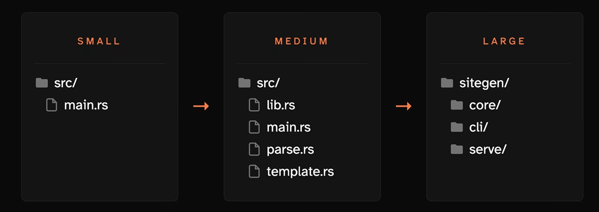
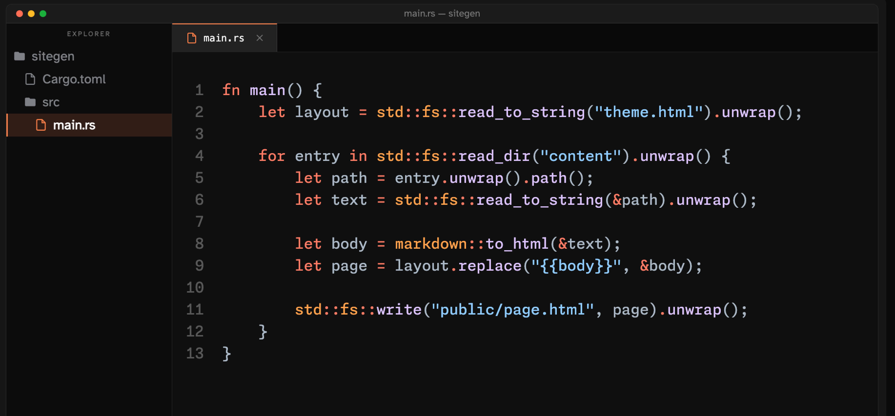
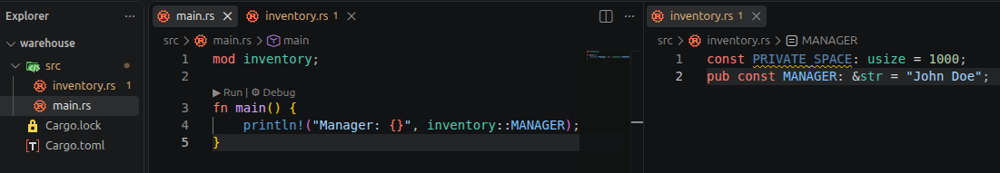
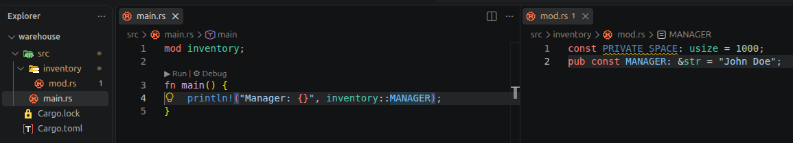
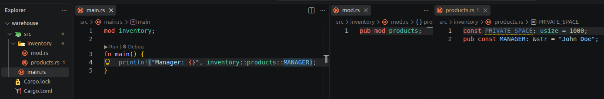
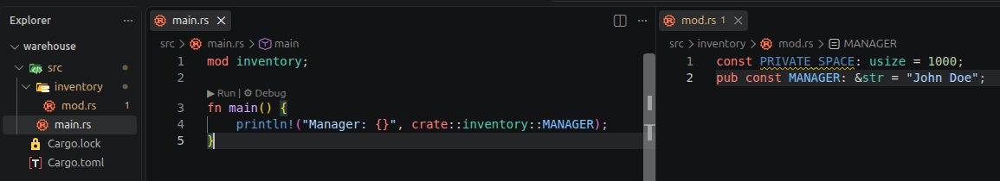

#  🧩 Project Structure



## 📗 **Packages & Crates**

A **package** is a folder with a `Cargo.toml`. The `Cargo.toml` file holds metadata about the package like its name and version.

In a more technical way, a **package** is a collection of one or more **crates**. A **crate** is a collection of Rust code that produces an executable or a library. A **crate** is the samllest amount of code that the Rust compiler considers at a time.

Types of Crates:
- **Binary Crate** -> is  a crate that  compiles to an executable. Has a **main** function that is the entrypoint for the executable.

- **Library Crate** -> Exports functionality for other Rust programs to share and use. Does not have a **main** function and does not compile to be an executable program. Dependencies are library crates.

## 📗 **Single `main.rs`**
The whole project in one file with a sinlge `Cargo.toml`



## 📗 **Module inside `main.rs`**
To organize things better we can use **modules**. A **module** is an organizational container that encapsulates related code. A module can live inside the `main.rs` file or in a separate file.

We use the **scope resolution operator** `::` and the `pub` keyword to access code inside the module.

```rust
mod constants {
    pub const NUMBER_PI: f64 = 3.14;
    const PRIVATE: &str = "I am a private constant";
}

fn main() {
    println!("Pi is {:.2}", constants::NUMBER_PI);
}
```

Its module has its own namespace, so we can have duplicated names
```rust
mod marketing {
    pub const MANAGER: &str = "John";
}

mod human_resources {
    pub const MANAGER: &str = "Carl";
}

fn main() {
    println!("Marketing Manager -> {}", marketing::MANAGER);
    println!("HHRR Manager -> {}", human_resources::MANAGER);
}
```

## 📗 **Module as File**



## 📗 **Module as Folder**



## 📗 **Module as Folder with Submodules**



## 📗 **Absolute and Relatives Paths**

An **absolute path** is the full, complete path to a name starting from the crate root. We use the `crate` keyword.



A **relative path** is the path to a name starting from the current location/module.

## 📗 **Aliases with `as`**
The `as` keyword gives an imported name a different name in the current scope. This is useful when two modules contain items with the same name.
```rust
mod marketing {
    pub const MANAGER: &str = "Marketing Manager";
}

mod human_resources {
    pub const MANAGER: &str = "HR Manager";
}

use human_resources::MANAGER as HR_MANAGER;
use marketing::MANAGER as MARKETING_MANAGER;

fn main() {
    println!("Marketing: {}", MARKETING_MANAGER);
    println!("Human Resources: {}", HR_MANAGER);
}
```

## 📘 **`use`, `self` and `super` Keywords**
The `use` keyword brings a name into the current scope. It creates a shortcut to a name in a nested module

```rust
mod constants {
    pub const NUMBER_PI: f64 = 3.14;

    pub mod other_constants {
        pub const NUMBER_E: f64 = 2.72;

        pub fn print_constants() {
            // `super` refers to the parent module: `constants`
            println!("Pi is {:.2}", super::NUMBER_PI);
            println!("e is {:.2}", NUMBER_E);
        }
    }
}

fn main() {
    // `self` imports the `other_constants` module itself
    use crate::constants::other_constants::{self, NUMBER_E};

    println!("e is {:.2}", NUMBER_E);
    other_constants::print_constants();
}
```

## 📘 **Large**

Instead of having a single `Cargo.toml` with as single dependencie list, shared by all crates, we use **workspace**. A workspace split the project into separate packages, making the root `Cargo.toml` listing the members.

```toml
[workspace]
resolver = "2"
members = ["core", "cli", "serve"]
```
Each workspace member is now its own package with its own `Cargo.toml`. Now building the CLI tool only compiles the needed libraries, it never pulls unnecessary dependencies of other members. That is the isolation a workspace provides